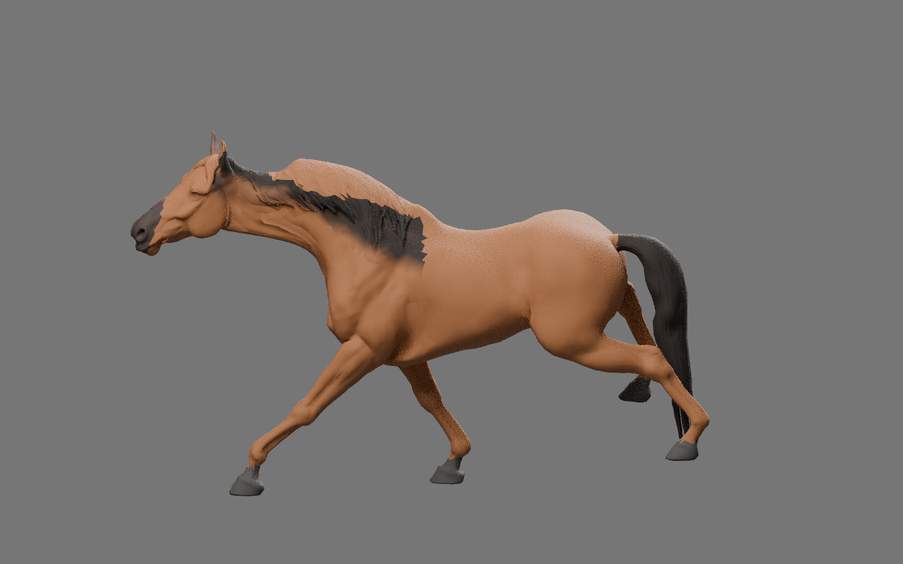
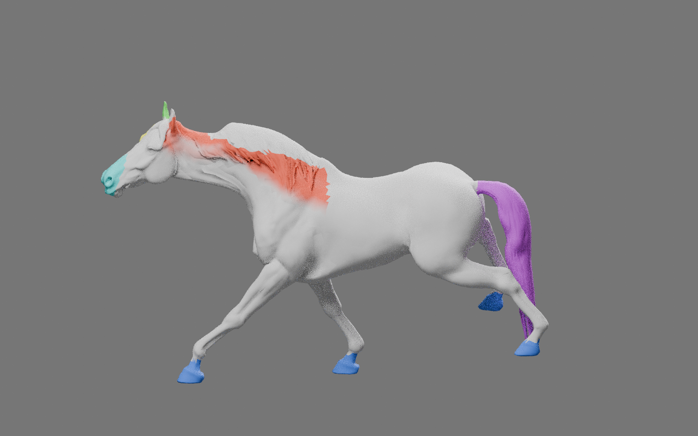

# 馬モデル試作 v3：完歩と毛色領域の修正

Claudeの指摘を受け、約7mの完歩、首を前へ伸ばす姿勢、毛色用の領域データを追加しました。参照倍率2.6、周期0.45秒（毎秒約2.22完歩）です。元のv2は別フォルダに残しています。

このブランチは受け渡し専用で、ゲーム本体への組み込みは未実施です。全ブランチをマージせず、必要な素材を取得してください。

## Claudeで取得

```sh
git fetch origin codex/tripo-horse-handoff
git show FETCH_HEAD:artifacts/tripo-horse-v3/horse-claude-handoff-v3.zip > /tmp/horse-claude-handoff-v3.zip
unzip /tmp/horse-claude-handoff-v3.zip -d /tmp/horse-claude-handoff-v3
```

展開した `CLAUDE_HANDOFF.md` に従い、独立した試作シーンへ取り込んでください。現在の馬と同じレース画面・速度で比較してから採否を判断してください。

GLB、Blenderファイル、元モデル、再生動画、Godotプレビュー、毛色シェーダー、再生成手順、検証結果を含みます。

## 注意点

- GLBはその場走行です。親の移動と再生倍率を合わせる式は引き継ぎ文書に記載しています。
- Godotの走行クリップ名は `RaceGallop`。v2の `Gallop` と周期が違います。
- UV2の領域を使う毛色シェーダーを同梱しています。UV2をライトマップ用に上書きしないでください。
- 首補正のブレンドシェイプも含みます。取り込み時の扱いは引き継ぎ文書を参照してください。
- 首・肩の形や毛色境界には調整余地があります。実写の走行に一致させた完成素材ではありません。

## 確認画像（Blender、1600×1000）





ZIP SHA-256: `d09529631aa488af1e2d7a26701b32f5f4cc08299912daf9612b8b2aef8d0c4c`
