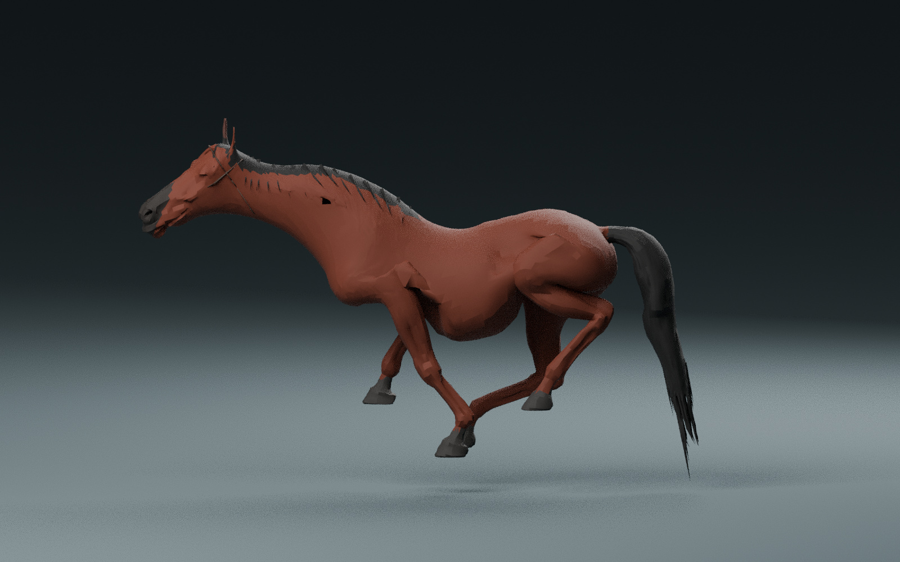
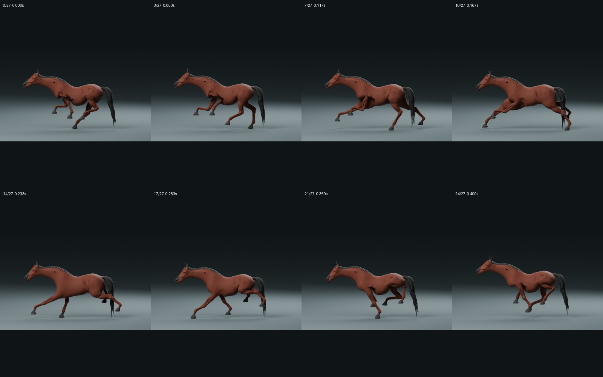
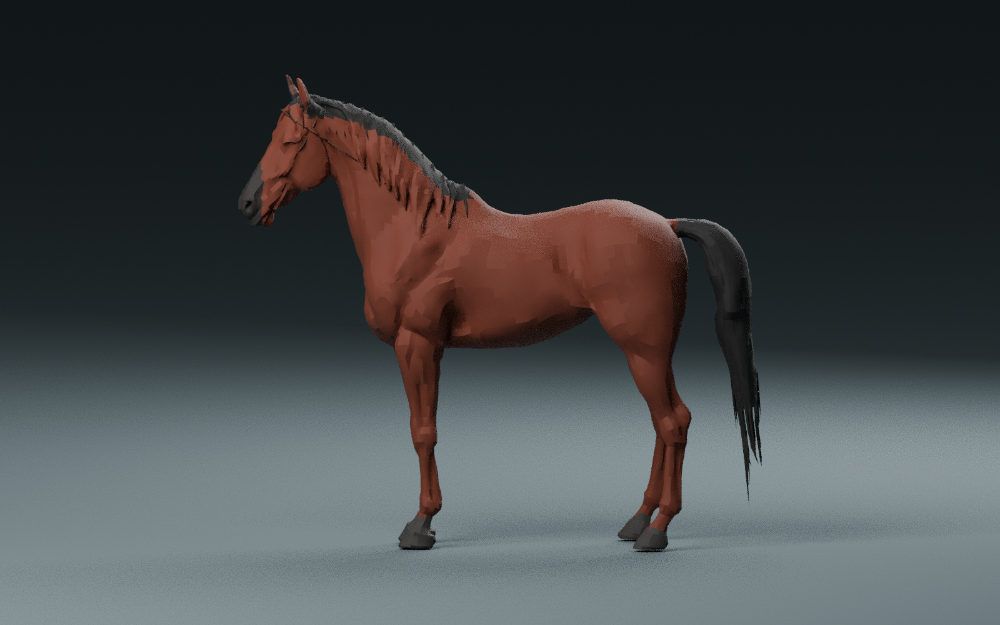

# Tripo Horse v4：跳ねる走り・立ち姿・騎手用取付点

滞空20%、肩の上下約11.9cm、完歩約7m。Stand・Walk・Race、鞍・あぶみ・はみの取付点と60fpsの動作記録を追加しました。UV2の符号化と54本の骨は維持しています。

ゲーム本体は未変更です。首・肩・毛の細部は調整余地が残る比較用の試作素材です。詳しい対応内容・検証・限界は [CLAUDE_HANDOFF.md](CLAUDE_HANDOFF.md) を読んでください。

## Claudeで取得

```sh
git fetch origin codex/tripo-horse-handoff
git show FETCH_HEAD:artifacts/tripo-horse-v4/horse-claude-handoff-v4.zip > /tmp/horse-claude-handoff-v4.zip
unzip /tmp/horse-claude-handoff-v4.zip -d /tmp/horse-claude-handoff-v4
cd /tmp/horse-claude-handoff-v4
sha256sum -c SHA256SUMS
```

このブランチ全体をマージせず、展開した引き継ぎ文書に従って独立した試作シーンで比較してください。元のV2・V3も別フォルダに残しています。

GLB・Blender原本・元GLB、Godotプレビュー、再生成ツール、測定JSON、騎手用JSON、側面28時点と正面・背面などの1600×1000画像を収録しています。







ZIP SHA-256: `81c484ed6cd8fc76a5e120f70f6f5bf0681248f8fed489e11d0ab1daef7cbda0`
