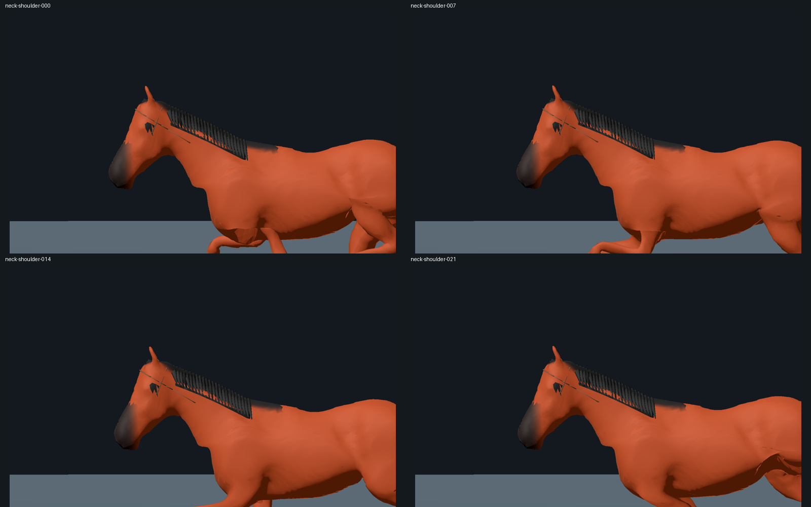

# 馬モデル v5

首と肩を修正した取り込み比較用の v5 です。**ゲーム本体は変更していません。**

Claude は最初に [CLAUDE_HANDOFF.md](CLAUDE_HANDOFF.md) を読み、[tripo-horse-v5.zip](tripo-horse-v5.zip) を展開してください。**GLB の差し替えと合わせて、付属毛色シェーダの法線補正・鼻先とたてがみの補間、および Godot import の optimizer 無効化を反映することが必要です。** 詳細とコードは引き継ぎ書にあります。

- 納品ブランチ: `codex/tripo-horse-handoff`
- 置き場所: `artifacts/tripo-horse-v5/`
- ZIP: `25,706,393` bytes
- ZIP SHA-256: `f82f0d521df748340366866e2a23e70a0609a8aa099825767cb13d9e09a8cd47`
- 最終 GLB SHA-256: `ec68c59db8131d29586cb5bfb9630d7cb9870e7b85dc7b1ba00ec91d6dc62223`

```sh
sha256sum tripo-horse-v5.zip
unzip tripo-horse-v5.zip -d tripo-horse-v5
cd tripo-horse-v5
sha256sum -c SHA256SUMS
```

ZIP 内に最終 GLB・Blender 原本・Tripo 元モデル・独立 Godot preview・再生成ツール・検証 JSON・1600×1000 の原寸画像133枚・シート・動画を収録しています。元入力だけの別ディレクトリで再生成し、GLB の SHA-256 が一致しました。

| 確認項目 | 結果 |
|---|---|
| 首 / 頭と首の角度 | 23.40〜25.87° / 100.06〜100.08° |
| 完歩 / 周期 | 約7m / 0.45秒を維持 |
| き甲の上下 / 浮く割合 | 14.85cm / 20% |
| 穴の境界辺 / 不整合な巻き順 | 0 / 0 |
| 三角形 / 骨 | 19,190 / 54 |
| 動作 | Stand・Walk・Trot・Canter・RaceGallop |

首のライン・接地・5動作・取付点・書き出し往復・Godot 実レンダーを確認済み。ただし、変形後の法線には補正が必要で、たてがみの根元などに細かな見た目の課題が残ります。検証範囲と残件を引き継ぎ書に記載しています。ゲーム内の騎手・LOD・実機負荷は取り込み後に比較してください。

[走行8コマ](run-sheet.jpg) · [首と肩4コマ](neck-shoulder-sheet.jpg) · [正面と背面](front-back-sheet.jpg) · [各歩法](gaits-sheet.jpg) · [走行動画](gallop-preview.mp4)



Claude への依頼文:

> `codex/tripo-horse-handoff` の `artifacts/tripo-horse-v5/README.md` と `CLAUDE_HANDOFF.md` を読み、ZIP を取得・検証して試作場面へ取り込んでください。付属シェーダの法線補正・鼻先/たてがみの補間と、Godot の AnimationPlayer optimizer 無効化も反映し、v4・現行馬・騎手を同じレース/時刻で比較してください。枝全体のマージは不要です。

配布 ZIP を別ディレクトリへ展開し、全211ファイルのハッシュと Godot の再インポート・5動作の検証を通過しました。[配布確認記録](delivery-validation.json)。
