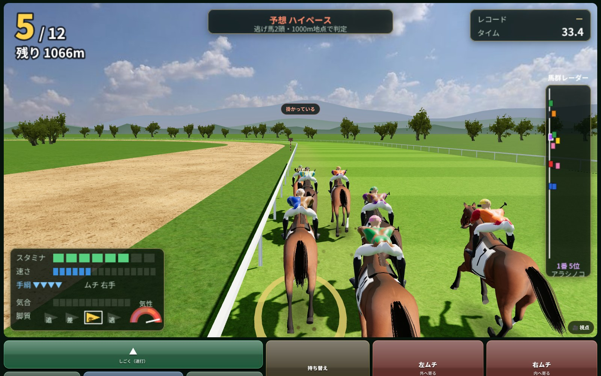
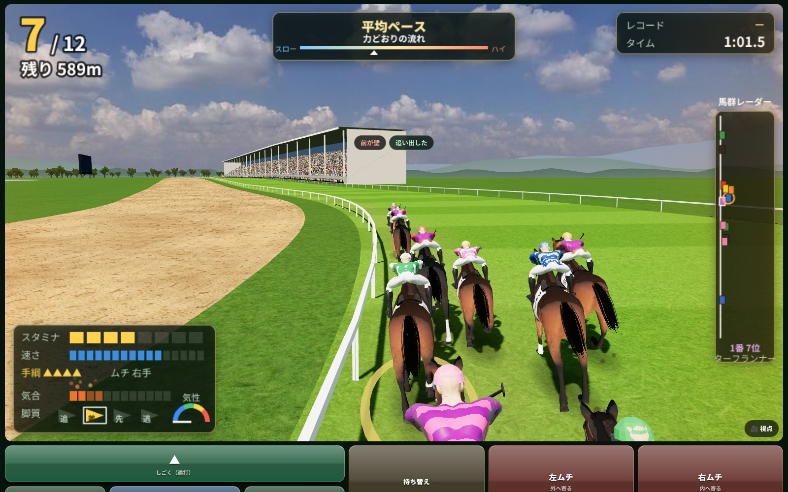
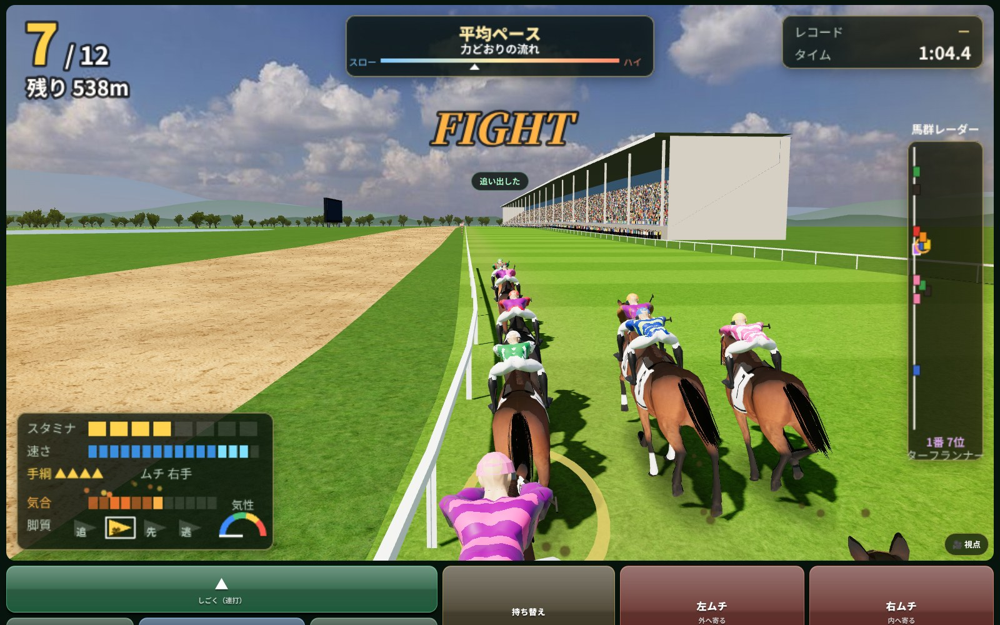

# 立ち回りの釣り合い（脚質・ペース・特殊能力・気性・競り合いの気合）と疲労

持ち主の言葉（2026-10-16）：

> ゲームバランス。ペースを読んだ立ち回りが大事なゲームです。ただし馬の気性によっては位置取りの融通が厳しく、変に立ち回ると折り合いがつかなくなってスタミナを使いまくって負けますので馬によります。脚質とペース、馬のスキルが立ち回りとして絡むようにしてください。脚質とペース読みとスキルが全部噛み合ったら格上も倒せるようなイメージです

> 折り合いゲージ。競り合ったときに根性が高い馬なら上げて欲しい。競り合ったことで気分が上がってることがわかるような表現をいれてほしい。

ここでは、どの数で何が変わるかと、決まった乗り方で測った結果を書く。数はすべて `js/core/racesim.js`（`HS.Sim`）と `js/core/skills.js`（`HS.Skills`）にある。

## 1. ねらいの手ざわり

| 乗り方 | ねらい | 測った結果（東京芝2000・14頭・各200回） |
|---|---|---|
| 噛み合った乗り方（ペースに合った位置と仕掛け・特殊能力の条件に合う運び） | 格上（総合力で3〜5上）にも3〜4割 | 4〜5上の相手に、気性の穏やかな馬で勝率 26〜37％（格上より先に入る 51〜57％） |
| おまかせ（騎手の腕で自動） | 真ん中 | 同じ相手に勝率 14〜17％ |
| 噛み合わない乗り方（ペースと逆の位置・仕掛け） | 強い馬でも負ける | 自分の馬が総合力で4上でも、勝率 3〜18％（おまかせは 20〜31％） |
| 何もしない（スタートだけ） | 負ける | 勝率 0〜5％ |

気性の荒い馬は位置の融通がきかないので、噛み合った乗り方でもおまかせとあまり変わらない（勝率 18〜26％・おまかせ 17〜25％）。そのかわり、脚質と違う位置へ動かすと掛かって大きく負ける（勝率 1〜2％・平均着順 12〜13着）。「馬による」の形。

## 2. 仕組み（数と効き目）

### 2-1. ペース（前からある）
- 逃げ馬の数でペースが片寄る（`S.PACE_NIGE`：0頭 −0.009・1頭 −0.002・2頭 ＋0.003・3頭以上 ＋0.008。ぶれ `S.PACE_SD` 0.006）。`paceF` が 1.006 より上でハイ、0.994 より下でスロー。
- 道中、前にいるほどハイなら脚を使い、スローなら楽をする（`S.PACE_K` 25）。後ろの馬は風よけで少し楽（`S.DRAFT` 0.08）。
- 終いの伸びの上限はペースで変わる（`S.PACE_TOP` 50）。スローは伸びきれない＝早めに動くのが得。ハイで直線の前から追い出すと脚がもたない（`S.PACE_EARLY` 60）。
- 騎乗の画面：上の真ん中に、決まった地点（2000m なら1000m）までは逃げ馬の数からの予想、過ぎたら判定と「どうすれば得か」を出し続ける。

### 2-2. 位置取り（手綱の段）— 今回作り直した
- 道中、手綱の段は**隊列の位置の注文**になった。しごけば前へ・引けば後ろへ。段 1 で `S.GEAR_GAP` 18m 前（段 −1 で 18m 後ろ）。段を戻さなければ、その位置を保つ。
- 注文の位置へ寄せる強さは `S.POS_K` 0.004（差 1m あたりの速さの割合）、上限 `S.POS_MAX` 0.03。寄せる間は速く走るぶん脚を使う（速さの3乗）。しごいている間はさらに ×(1＋`S.GEAR_COST` 0.05×段)。引いている間は ×(1＋0.1×段)（脚がたまる）。
- 前の形は、段のぶん速さをずっと足し、脚も ×(1＋0.6×段) ずっと使っていた。位置を保つだけで脚がなくなり、ペースを読んで前へ行っても得にならなかった。
- 早くから追い通すと脚がもたない：しごいた状態で直線の手前 `S.EARLY_PUSH` 500m より前を巡航より速く走ると、脚の減りが ×(1＋8×速さの超過)。前は「残り600mより前」で、自然の仕掛けどころ（残り800m前後）で追っても損になり、自分で乗ると何をしてもおまかせより2〜4着悪かった。

### 2-3. 気性と折り合い（騎乗の気分）— 今回作り直した
自分で乗る馬だけにある気分（0〜100。騎乗の画面の左下の「気性」の針）。AI の馬は前と同じ（掛かるかはレースの初めのくじ）。
- 何もしなければ、その馬の**落ち着く気分**へ寄っていく：`S.TENSION.base` 25 ＋ (70−気性)×`hot` 0.5（掛かりやすい日は ＋`kakari` 15）。毎秒 `settle` 0.08 の割合で寄る。前の馬の真後ろにいると毎秒 `calm` 1.2 落ち着く。
- **脚質の位置から外れると上がる**：外れた割合（前から何割目かで、`S.ZONE` の外へ出た分）×`S.MISFIT` 10×(気性の荒さ)²。気性の荒さは `S.temperF`＝1＋(70−気性)/25（気性45で2倍、70以上で1）。自由自在の馬は ×0.35。距離の `S.MISFIT_FROM` 20％までは数えない（隊列が決まるまで）。
  - 例：差しの馬を先頭集団（外れ 0.2）に置くと、気性80の馬は毎秒＋2（落ち着く先から25ほど上で止まる）、気性48の馬は毎秒＋7（すぐ掛かる）。
- **動かすと上がる**：しごくと 段の上げ幅×12×荒さ、急に引くと 下げ幅×14×荒さ（ゆっくり引くと ×4×荒さ）、道中に進路を1つ変えると `lane` 8×(荒さ−1＋0.15)（気性の荒い馬を外へ出すと掛かる。穏やかな馬は1ほど）。
- **気分が脚に効く**：50を越えると脚の使い方が ×(1＋(気分−50)/100×`S.TENSE_COST` 1)、75を越えると掛かって ×`S.KAKARI_COST` 1.6（行きたがって少し前へ出る）。35未満で折り合うと ×`S.CALM_SAVE` 0.97。追い出したあとは気分が下がっていく。

### 2-3b. 折り合いの仕組み（生き物を操っている手ざわり）
持ち主の言葉（2026-10-16）：「折り合いについては生き物を操作してるように感じるように作り込んで欲しいです」。数は `S.ORIAI`・`S.bondF`・`S.cowardOf`・`S.respOf`、中身は `S.oriaiStep`（自分で乗る馬だけ。AI の馬・おまかせは前と同じ）。

- **遅れて寄る**：気分は「落ち着く先」へ毎秒 `S.TENSION.settle` 8％ずつ寄る。落ち着く先＝25＋(70−気性)×0.5＋その日の掛かりやすさ＋**高ぶり**（surge）。何かが起きても、気分はすぐには跳ねず、数秒かけて上がり、数秒かけて下がる。
- **高ぶりの波**：周りの出来事で高ぶりが上がり、`surgeT` 6秒ほどで引いていく（掛かり始め → 山 → 落ち着く）。高ぶりは `surgeMax` 45 まで。
  - 抜かれる（すぐ横を速い馬が通る。1頭につき10秒に1回）：`passed` 9 ×(荒さ−1＋0.15)。先行・逃げは ×1.3。臆病な馬は小さい。
  - 前が壁（3秒に1回）：気の荒い馬は `wall` 4 ×(荒さ−1＋0.15) 高ぶる。臆病な馬（`S.cowardOf`＝(72−根性)/25、接戦に弱い馬は＋0.3）が0.5より上なら、高ぶるかわりに**縮こまる**（shrink：道中の速さが最大 −1.2％、耳を伏せる。4秒ほどで戻る）。
  - 砂をかぶる（ダートで前の真後ろ・2秒に1回）：`sand` 3 ×（砂かぶり×の馬は2.5、ほかは荒さと臆病さで）。
  - 外から被される（外に並ばれ、内も馬かラチ・3秒に1回）：馬混み嫌いの馬は `cover` 4×1.5、ほかは荒さで。臆病な馬は縮こまる。
- **手綱の慣性**：引いている長さ（pullT）で効きが増え、`ramp` 2.5秒で満額（毎秒 `calmK` 5×引く深さ）。1秒ではほとんど変わらない。そっと引いて（段の深さ0.12以上）合わせると、高ぶりの引きが3倍速い（`match` 0.35）。高ぶっているときにしごくと、さらに行きたがる（`pushSurge`）。
- **引きすぎるとケンカ**：行きたがっている（気分が `keen` 40 より上の）馬を、段の深さ `over`（0.55。気性の荒い馬ほど浅く、気性45で0.3）より深く `fightAfter` 1.2秒より引き続けると、頭を上げてケンカし、毎秒（深さ−over）×`fightK` 14×荒さ だけ気分が上がる。落ち着いた馬を後ろに置くだけならケンカしない。引く強さと長さに「ちょうどいい」がある。
- **ムチへの素直さ**：追い出したときの気分が35以下なら直線のムチの伸びが ×1.1、そこから下がって気分75で ×0.6（そのぶん脚も最大 6％多く使う）（`S.respOf`）。折り合っていた馬ほど素直に応える。
- **絆**：同じ馬に自分で乗った回数（`G.bond[馬のid]`。週の終わりに、自分で乗ったレースごとに1つ増える。前のセーブは `World.migrate` で空から）。気性の荒さの効きが ×`S.bondF`（初騎乗 1.15・1回 1.1・2回 1.05・3回 1・12回以上 0.8）。初騎乗は少し難しく、乗るほどつきやすい。フリーレースは絆を使わない（1）。
- **3D 用の値**（全馬・毎刻み。`S.moodOut`）：`s.kakari`（掛かり＝ハミに逆らう強さ・頭の上げ具合 0〜1。気分50から上がり、引きすぎのケンカで1。AI の馬は掛かりやすい日の前半に0.7）と `s.ears`（耳 −1 伏せる〜1 前へ。折り合うと前、掛かると後ろ、縮こまると伏せる、競り合って気合が乗ると絞る）。模擬の結果には効かない。race3d.js にはまだつないでいない。
- **見せ方**（騎乗中は文字を出さない）：気性の針が、高ぶり・掛かりで不規則に震え、引きすぎのケンカで大きく暴れる。掛かっている間は文字盤が赤く脈打ち、折り合っている（気分35未満）間は青く静かに光る。掛かり始めとケンカで鼻息（ブルッ）とコントローラーの強い一揺れ、掛かっている間は拍子の外れたガツガツした揺れ。折り合うと、ふうっと息を吐く音。

| 絆（差し・気性55）| 道中の気分の平均 | 掛かった割合 | 平均着順 |
|---|---|---|---|
| 噛み合った・初騎乗 | 49 | 21％ | 7.27 |
| 噛み合った・3回 | 46 | 16％ | 7.14 |
| 噛み合った・12回 | 43 | 9％ | 7.00 |
| 噛み合わない・初騎乗 | 59 | 58％ | 12.54 |
| 噛み合わない・3回 | 56 | 52％ | 12.39 |
| 噛み合わない・12回 | 51 | 40％ | 12.10 |

### 2-3c. 横の移動（自分で乗る馬）
持ち主の指摘（2026-10-16）「パッドの十字キーで横移動できない」。前は1秒に1進路しか動かず、手を離して3秒たつと勝手に内へ戻り始めたので、押しても動かないように感じた。
- 押すとすぐ動く：毎秒 `S.LANE.v` 3進路（0.2秒で0.6進路）。
- 手を離しても戻らない：何もしないまま `S.LANE.drift` 10秒たち、内が空いているときだけ、内ラチへ1つずつ寄る。
- ぶつかると止まる：前後 `dx` 2m 以内で、動く向きに進路の差が `gap` 0.8 より近い馬がいれば止まり、押した向きの注文は取り消す。止まった時刻と向きを `sim.ctl.bumpT`・`bumpSide` に出す（騎乗の画面の振動と揺れに使う）。
- 道中に進路を変えると、気性の荒い馬ほど気分が上がる（2-3）のは同じ。

### 2-4. 仕掛けとムチ
- 追い出しは、自然の仕掛けどころに来るか、直線の手前500mより後ろでしごいて段を0.35より上げると始まる。段がいちばん上で、おまかせと同じ伸び（`S.PUSH.base` 0.25 が馬なりの伸び）。
- 直線のムチ：伸び ×(1＋`S.WHIP.k` 0.4×切れの伸び×ムチの効き)、続けて打つと風車ムチで 0.6。脚の使い方 ×0.96（風車 0.98）。直線の前のムチは伸び 0.2・脚 ×1.2。前は 0.6・0.9・脚 0.9 で、直線の手前から追ってムチを入れるだけでおまかせの3倍以上勝てた。

### 2-5. 特殊能力（立ち回りと絡むもの）
- 一気系（最後方一気・直線一気・大外一気）は、**ためた脚で伸びが変わる**：発動したときのスタミナ E で、速さの倍率が ×(`HS.Skills.IKKI.a` 0.4＋`b` 2×E)（0.6〜1.6倍）。さらに、そのあと終いの伸びの上限が上がる（`fx.top`：最後方一気 0.3・直線一気 0.2・大外一気 0.2）。脚が残っていないと上限が上がっても使えない。後ろでためて直線で使う運びが得。
- 逃げ粘り（残り600mで先頭）・単騎逃げ・4角先頭は前で運ぶと、まくり・直線一気は後ろから、瞬間の反応は直線までムチを使わないと発動する（docs/SKILLS.md）。
- 自由自在：位置の融通（気分の上がり方 ×0.35）と、ペースを見て自分で位置を変える（AI のとき）。

### 2-6. 競り合いの気合 — 今回足した
自分の馬にも AI の馬にも効く（模擬は種で決まるまま）。騎乗の気分（掛かり）とは別の、良い向きの上がり方。
- 3〜4コーナーから先（残りが 直線＋`S.FIGHT.from` 300m より短い、または追い出したあと。距離の30％より後ろ）で、**すぐ横**（前後 `dx` 2.4m＝1馬身以内・進路が `l0` 0.45〜`l1` 1.8 離れた隣・速さの差 `dv` 0.6m/s 以内）に馬がいる間、気合が動く。
- 根性が `g0` 72 より高いほど上がる（根性100で毎秒 `up` 10。根性86で毎秒5）。72より低いとひるんで下がる（根性55で毎秒−6、下限 `low` −40）。（並ぶと強いは 2026-10-17 に持ち主の判断でなくした。ど根性と同じなので）
- 横に馬がいなくなると、毎秒 `decay` 5％ずつ0へ戻る（3〜4コーナーの競り合いが直線まで残る）。
- 効き目（気合100のとき）：追い出したあと・バテたあとの速さ ×(1＋`spd` 0.012)、脚の使い方 ×(1−`cost` 0.12)。ひるみ（負）は速さだけ下がる（−40で −0.5％）。前の「ゴール前250mで並ぶと根性で ×(1＋0.004×(根性−70)/30)」はこれに置き換えた。
- 騎乗の画面：左下の計器に「気合」の目盛り（12）。上がっている間は橙から金に燃えるように揺れ、火の粉が立つ。ひるむと青い帯。競り合っている相手の側の画面の縁が橙に脈打ち、馬群レーダーの相手に橙の輪。気合が50を越えた瞬間に FIGHT（英語の短い合図）・駆け上がる音・コントローラーの振動（鼓動のように2回と長めに1回）。気合が乗っている間は蹄の震えも強くなる。

騎乗の画面の絵（`NODE_PATH=$(npm root -g) node tools/shot_ride.js`。1600×1000）：

| 気合が上がっている途中 | 気合が乗りきった瞬間（FIGHT） |
|---|---|
|  |  |

## 3. 測り方

`node tools/balance_bench.js [field|upset|strong|fight|all] [N]`。東京・芝2000・14頭（頭数合わせの馬、level 82）。1頭目に自分で乗り、決まった乗り方の打ち手（`tests/ridebot.js`）で N 回走らせる。気性・根性を変えるときは、強さ（重み付きの能力の値）が変わらないようスピードで埋め合わせる。総合力の1は能力の重み付きの値でおよそ 0.86。

ここ（2〜6）の「総合力で4上」などは、前の総合力の式（根性・気性・坂も入れた重み付きの値。11 を見よ）で数えた差。いまの総合力（スピードとスタミナだけ）では、同じ差がおよそ1.2倍（4上 → 5上ほど）になる。

| 乗り方 | 中身 |
|---|---|
| おまかせ | 模擬を自分で乗らない形で作る（騎手の腕で自動に乗る） |
| 何もしない | スタートだけ切る |
| ただ追う | 位置は気にせず、直線の手前350mからしごいて、直線でムチ。直線の手前から前の空いた進路へ出す |
| 噛み合った | ペースを読む（決まった地点までは逃げ馬の数から）。気性の穏やかな馬・自由自在は、スローなら前へ・ハイなら後ろへ、隊列の3割ほど動かす。荒い馬は動かさない（気分が60を越えたら手綱を戻す）。仕掛けはスロー＝直線の手前460m・平均＝350m・ハイ＝80m（荒い先行馬はハイでも350m）。スローで逃げ粘りなどを持つ先行馬はハナへ、ハイで直線一気などを持つ馬は後ろでためる。直線でムチ・進路 |
| 噛み合わない | ペースと逆へ（スローで後ろ・ハイで前、平均でも脚質と違う位置へ）隊列の45％ほど動かし、仕掛けも逆（スロー＝80m・ハイ＝460m） |

## 4. 結果（各200回。折り合いの仕組みを入れたあとの値）

### 同じ強さの相手（全頭 level 82）。勝率％／平均着順

| 脚質・気性 | おまかせ | 何もしない | ただ追う | 噛み合った | 噛み合わない |
|---|---|---|---|---|---|
| 逃げ・荒い（気性48） | 6％／10.4 | 0％／12.6 | 8％／11.7 | 8％／11.7 | 1％／13.4 |
| 逃げ・穏やか（気性88） | 4％／9.3 | 0％／9.9 | 24％／7.7 | 21％／7.3 | 9％／9.5 |
| 先行・荒い | 11％／7.4 | 1％／10.2 | 21％／8.4 | 22％／8.1 | 1％／12.8 |
| 先行・穏やか | 7％／6.9 | 0％／9.0 | 31％／5.8 | 28％／5.1 | 12％／9.7 |
| 差し・荒い | 16％／7.1 | 0％／10.0 | 14％／7.9 | 15％／8.0 | 2％／12.7 |
| 差し・穏やか | 11％／7.0 | 0％／9.9 | 14％／6.5 | 23％／5.3 | 4％／11.3 |
| 追込・荒い | 10％／8.6 | 0％／11.0 | 5％／9.4 | 10％／8.5 | 2％／13.2 |
| 追込・穏やか | 9％／7.7 | 0％／10.8 | 9％／7.2 | 14％／6.0 | 6％／10.6 |

### 格上の相手（1頭だけ自分の馬より総合力で4・5上、ほかの12頭は3下）。勝率％・格上より先に入る割合％

| 相手・脚質・気性 | おまかせ | 何もしない | ただ追う | 噛み合った | 噛み合わない |
|---|---|---|---|---|---|
| +4 先行・荒い | 19％・38％ | 1％・19％ | 24％・37％ | 26％・39％ | 1％・8％ |
| +4 差し・荒い | 25％・41％ | 0％・23％ | 19％・35％ | 19％・35％ | 2％・8％ |
| +4 先行・穏やか | 17％・39％ | 1％・27％ | 31％・49％ | **37％・57％** | 16％・28％ |
| +4 差し・穏やか | 17％・42％ | 0％・24％ | 22％・44％ | **28％・54％** | 8％・19％ |
| +5 先行・荒い | 17％・36％ | 1％・17％ | 22％・34％ | 24％・36％ | 1％・8％ |
| +5 差し・荒い | 23％・38％ | 0％・21％ | 19％・34％ | 18％・34％ | 1％・7％ |
| +5 先行・穏やか | 14％・36％ | 1％・25％ | 30％・48％ | **36％・56％** | 14％・25％ |
| +5 差し・穏やか | 15％・40％ | 0％・21％ | 19％・39％ | **26％・51％** | 8％・16％ |

### 強い馬（自分の馬だけ総合力が4上）でも、噛み合わないと負ける。勝率％／平均着順

| 脚質・気性 | おまかせ | 何もしない | ただ追う | 噛み合った | 噛み合わない |
|---|---|---|---|---|---|
| 先行・荒い | 23％／6.2 | 5％／9.1 | 27％／7.2 | 28％／7.1 | 3％／12.1 |
| 差し・荒い | 31％／5.9 | 1％／8.7 | 23％／6.8 | 26％／6.8 | 2％／11.9 |
| 先行・穏やか | 20％／5.4 | 1％／7.7 | 41％／4.7 | 44％／4.0 | 18％／8.3 |
| 差し・穏やか | 24％／5.4 | 0％／8.6 | 30％／5.0 | 38％／4.1 | 10％／10.0 |

### 根性だけを変えた馬（強さは同じ・おまかせ）

| 根性 | 勝率 | 平均着順 |
|---|---|---|
| 55 | 9％ | 8.56 |
| 70 | 9％ | 8.28 |
| 85 | 10％ | 7.51 |
| 95 | 10％ | 7.19 |

（5秒並んで競り合うと、根性95の馬は気合が41まで上がり、根性55の馬は−30までひるむ。tests/extra_balance.js）

## 5. 読み方と、調整の手がかり

- **噛み合ったときの得**を大きくしたいなら：`S.PACE_K`（前後の位置の損得）・`S.PACE_TOP`（スローの伸びの上限）・`S.PACE_EARLY`（ハイの早仕掛けの損）を上げる。ただし AI の脚質の釣り合い（tests の「平均ペースは脚質がおおむね釣り合う」）も動く。
- **気性の荒い馬の損**を大きく・小さくしたいなら：`S.MISFIT`（外れたときの上がり方。荒さの2乗が掛かる）・`S.KAKARI_COST`・`S.TENSE_COST`・`S.TENSION.hot`（何もしなくても気分が高めになる分）。荒い馬を普通に乗っただけでおまかせより悪くなるのは、主に `hot` と `TENSE_COST`。
- **ただ追うだけ**が強すぎるなら：`S.WHIP`（直線のムチ）と `S.CALM_SAVE`。
- **競り合いの気合**を強く・弱くしたいなら：`S.FIGHT.spd`・`cost`（効き目）、`up`・`g0`（上がり方と、ひるむ根性の境）。
- 気性の荒い馬は、噛み合った乗り方でもおまかせとあまり変わらない。AI の騎乗（おまかせ）には騎乗の気分が無く、掛かるかはレースの初めのくじだけなので、荒い馬はおまかせのほうが楽に乗れる。「難しい馬を自分で乗りこなす得」を足すなら、ここが次の手がかり。
- 逃げ馬は、おまかせだと勝率 4〜6％と低い（同じ強さで比べると、逃げは道中のペースの損を受けやすい）。自分で乗って直線の手前から追うと 11〜23％。

## 6. テスト（tests/extra_balance.js）
- 噛み合った乗り方はおまかせより平均着順が0.5より良く、噛み合わない乗り方はおまかせより1.5より悪い（先行・差し、気性の穏やかな馬）。
- 気性の荒い馬は、噛み合わない乗り方で半分より多く掛かり、穏やかな馬（掛かりは2割未満）より平均着順が0.6より悪い。
- 5秒並ぶと根性95の馬の気合が30より上がり、根性55の馬はひるむ。離れると少しずつ戻る。道中（3コーナーより前）の並走では上がらない。強さが同じなら根性95の馬のほうが根性55の馬より平均着順が0.4より良い。
- 一気系の伸びは、ためた脚（スタミナ）で変わり、終いの上限を上げる。
- 折り合いの慣性：気分70の馬をそっと引く（段 −0.3）と、1秒ではほとんど変わらず、4秒では何もしないより3倍以上下がる。行きたがる馬を引きすぎる（段 −0.8）と、そっと引くより気分が10より高くなり、頭を上げる（kakari 1）。気分25の馬は引きすぎてもケンカしない。
- 周りへの反応：抜かれると、気性の荒い馬は穏やかな馬の3倍より高ぶる。臆病な馬（根性50）は壁で縮こまり、気の荒い馬（根性85）は高ぶる。
- 絆：12回乗った馬は初騎乗より、道中の気分が3より低く、掛かる割合も低い。前のセーブに G.bond ができる。
- 全馬の掛かり（s.kakari）・耳（s.ears）の値が範囲（0〜1・−1〜1）の中。
- 横の移動：押して0.2秒で0.4進路より動き、手を離して8.5秒たっても戻らず、すぐ横の馬に向かって押すと止まって bumpT を出す。

## 7. 疲労（2026-10-19。故障はなくした）

持ち主の仕様書（docs/SPEC.md「疲労」）：

> 疲労がたまった状態でレースに出るとデバフがかかる。すごい G1 ほど消耗しやすい（→ 2026-10-20 に外した。下の 7-7）。脚を余らせて勝つと疲労はたまりにくい。激戦だと疲労がよくたまる。回復力は馬の健康パラメータによる。海外遠征すると移動時に少し疲労がたまる（同じ国にずっといれば大丈夫）。疲労の段階などは要調整。めちゃくちゃ強ければ連闘しまくっても大丈夫にしたい。**故障はなしにする。**

数は `js/core/fatigue.js`（`HS.Fatigue`。たまり方・回復・移動）と `js/core/racesim.js` の `S.FATIGUE`（段階と強さの下げ）。Godot 版は `godot/core/hs_fatigue.gd`・`hs_sim.gd` の `FATIGUE`・C++ の `hs_horse.cpp`（同じ数。一致テストで確かめる）。疲労は 0〜100（`h.fatigue`）。

### 7-1. 段階と下げ（レースの前の疲労で決まる。移動の疲れも足して見る）
| 段階 | 疲労 | 下げ（点） |
|---|---|---|
| 万全 | 0〜14 | 0 |
| 軽い疲れ | 15〜34 | 1.5 |
| 疲れ | 35〜54 | 4 |
| 疲れが濃い | 55〜74 | 8 |
| 使いすぎ | 75〜 | 13 |

- 馬の状態は、この5段階だけで見せる（調子は無い。7-7）。

- 1点はおよそ2000mで1馬身（強さの点が1上がると巡航の速さが0.12％上がる）。
- **強い馬ほど下げが小さい**：下げ×（1−（能力の重み付きの値−86）÷18.3×0.8）。86（総合力61ほど）より下は1倍、上がるほど縮んで、104.3（総合力85）で0.2倍が下限。（下の表の総合力は前の式で数えた値。いまの総合力では、能力のそろった馬で 86 が62ほど・104.3 が82ほど）

| 総合力 | 61以下 | 65 | 70 | 75 | 80 | 85 |
|---|---|---|---|---|---|---|
| 下げの倍率 | 1 | 0.86 | 0.67 | 0.51 | 0.36 | 0.2 |
| 「使いすぎ」の下げ（点） | 13 | 11.1 | 8.7 | 6.7 | 4.6 | 2.6 |

- AI の馬は「疲れ」（35）より上なら出ない（前は疲労40より上）。休み（`restUntil`。G1 のあと5〜8週・ほかは3〜6週）は前と同じなので、AI の出走の間隔はほとんど変わらない。

### 7-2. レースでたまる量
たまる量＝（8＋距離100mごとに0.7）×格×激戦の度合い。グランドフェスティバルではたまらない。

| 格 | 倍率 |
|---|---|
| G1 | 1.2 |
| G2 | 1.05 |
| G3 | 0.95 |
| オープン | 0.85 |
| 条件戦 | 0.8 |

- すごい G1 だけ重くする決まり（前は21の G1 を1.5倍）は外した（持ち主の決定 2026-10-20「すごいG1だと相手が強いので結果的に激戦になって勝手に疲労が溜まる」）。強い相手と走ると激戦の度合いが上がって多くたまる（7-7）。
- 激戦の度合い（0.6〜1.4）＝0.6＋0.4×着差の近さ＋0.4×脚の使い切り。
  - 着差の近さ：勝ち馬は2着との差（0馬身で1、3馬身で0）。ほかの馬は勝ち馬からの差（0馬身で1、4馬身で0）。
  - 脚の使い切り：ゴールで残ったスタミナ（`endE`）が0.25以上で0、0以下で1（勝ち馬の残りは真ん中で0.09）。
- 例（2400m）：ジャパンカップをハナ差で脚を使い切って勝つと 41.5、6馬身ちぎって脚を余らせて勝つと 17.9。G3 の激戦 32.8、条件戦の激戦 27.6。

### 7-3. 回復（毎週。レースに出た週も）
1週に抜ける量＝5＋（健康−50）×0.2（下限2）。牧場では2倍。休ませる調教（軽め・休養）は少し余分に抜ける（メニューのきつさの半分）。前は調教のきつい週に疲労が増えたが、疲労はレースでだけたまる形にした。

| 健康 | 1週に抜ける量 | 疲労80が0になるまで |
|---|---|---|
| 55 | 6 | 14週 |
| 75 | 10 | 8週 |
| 95 | 14 | 6週 |

- 史実馬の健康はデータに無ければ75前後（30〜100）。ジャパンカップを激戦で勝った健康75の馬は、次の週32（軽い疲れ）・中1週22（軽い疲れ）・中3週2（万全）。ジャパンカップから4週あとの有馬記念には万全で出られる。

### 7-4. 移動（国が変わるとき）
| 移り方 | 移動の疲れ |
|---|---|
| 同じ国に居続ける | 0 |
| 同じ地域の別の国（英→仏・米→加・豪→新など） | 4 |
| 地域をまたぐ（日本→欧州・欧州→米・海外→日本など） | 8 |

- いる国（`h.at`）は、最後に走ったレースの国（日本の馬が日本へ戻ると消える）。外国で調教された馬は、はじめにいる国が無い（最初のレースはどこでも移動なし）。GF には移動の疲れが無く、いる国も動かない。
- 移動の疲れは出走表（`runner.travel`）に載り、そのレースの下げに入り、レースのあと疲労に残る。
- **連闘で別の国へは行けない**：前のレース・今週の出走登録・予約のどれかと1週しか離れていない、別の国のレースには出られない（「移動が間に合わない」）。中1週（2週あける）なら出られる。番組表に理由が出て、予約もはねる。同じ国の中なら連闘できる。

### 7-5. 測った値
- 連闘の筋書き（模擬だけ。ジャパンカップ・G1 級の相手13頭・健康75、5週続けて出て4・5戦目を見る。各24回）：総合力85の馬は勝率 88％ → 85％（疲労56ほどでも勝つ）。総合力65の G1 馬は平均着順 6.1 → 8.9着（疲労69）。（2026-10-20・すごい G1 の重さと調子を外したあと。前は 90％ → 88％・6.1 → 8.7着）
- 疲労80（使いすぎ）で出ると、総合力65の馬の平均着順は 4.7 → 6.9着（80回）。
- 自動で2年遊んだ（騎手のゲーム・種11・お手馬4頭はおまかせ）：前／後

| | 前 | 後 |
|---|---|---|
| 1頭あたりの年間出走数（全部の史実馬・名を残した馬） | 2.83 | 2.85 |
| 自分の馬（おまかせ4頭）の年間出走数 | 5.0 | 4.75 |
| 連闘（1週あと）の数 | 1 | 1 |
| 中1週の数 | 6 | 6 |
| 故障 | 74頭 | 0 |
| レースの前の疲労（平均・上の1割） | 3.5・15.2 | 0.1・0 |

### 7-6. テスト（tests/extra_fatigue.js）
- 故障が起きない（16週・調教とレースと牧場）。故障の仕組み（`H.injure`・調教の危険の値）が無い。前のセーブの故障は読み直すと消える。
- G1 の激戦 ＞ G3 の激戦 ＞ 条件戦の激戦、余裕勝ちは激戦の65％未満、僅差の2着は大差の2着より多い、長い距離ほど多い。すごい G1 の表が無く、G1 の名前でたまる量が変わらない。
- 同じ強い馬がジャパンカップで、少し下の相手（競り合う）と走ると、ずっと弱い相手（楽に勝つ）より多くたまる。
- 調子が無い：前のセーブの調子の値（±100）で強さが変わらない・新しい馬と調教に調子が無い・読み直すと調子の項目が消える・週を進めても調子の項目ができない。調教師のひと言は疲労の段階から。
- 健康55・75・95 の順に早く抜け、牧場ではもっと早い。
- 段階の境目・段階ほど下げが大きい・段階の名前（万全・軽い疲れ・疲れ・疲れが濃い・使いすぎ）。疲労60で強さが3点より下がり、移動の疲れも同じに効く。疲労80で平均着順が1.2より悪くなる。
- 総合力80より上の馬は連闘の4・5戦目でも疲労が45より上にたまり、勝率5割より上で、休み明けより15ポイントより落ちない。総合力65の馬は0.8着より悪くなる。
- 移動の疲れ（居続け0・同じ地域4・地域をまたぐ8・GF 0）・いる国の移り。連闘で別の国は出走・番組表・予約ではねる、中1週と同じ国は出られる。出走表の移動の疲れがレースのあとの疲労に残る。
- Godot：`tools/golden_world.js` の craft の週の操作 `away`（先週は仏で走った）・`fat`（段階・回復・今週の全レースへの移動の疲れと出られるか・決まった着順の並びでたまる量）を GDScript と比べる。

- AI の馬は休み（`restUntil`）で間をあけるので、疲労はほとんど残らずに出る。疲労が効くのは、自分で詰めて使ったとき（連闘・中1週）と、史実馬が史実の使い方で続けて走るとき。

## 8. 出走の条件（2026-10-20。レースは OP 以上だけ）

持ち主の決定（2026-10-20）：

> レースはOP以上のみでお願いします　最初からOPでれます　未勝利戦や新馬戦、条件戦はなくてよいです　なので未勝利戦からにはなりません　G2までは無条件でれます　G1は獲得賞金条件があります　海外G1の特に2歳については条件未定です

> 豪州の2歳 G1 には出られない（仕様書の末尾）

数は `js/core/races.js`（`HS.Races`）と `godot/core/hs_races.gd`（`HSRaces`）。同じ種で同じ結果になることを `tools/golden_world.js` で確かめる。

### 8-1. 週のレース
- 重賞（G1・G2・G3）はデータの暦から。新馬戦・未勝利戦・条件戦（1勝〜3勝クラス）は無い。
- オープンは開催場ごと（`HS.DATA.meets`。月に3場）に `R.openOf` が作る：2歳（6月から）を1つ・9月からは4割でもう1つ、3歳（9月まで）を1つ、古馬（5月までは4歳以上・6月からは3歳以上）を1つと5割でもう1つ。どれも3割でリステッド（L）、15％で牝馬限定。鍵は `年-月-週-o場-番号`。
- 1着賞金（1995年の物価）：OP 2300万円・L 2600万円（`R.CLS_PRIZE`）。
- その場限りの馬（頭数合わせ）の強さ（`W.fillerLevel`）：2歳オープンは 6月 56 から月に1ずつ上がり 12月 62。3歳オープンは 4月まで 64・6月まで 66・7月から 69。古馬オープン 70。リステッドは1上。重賞は前と同じ（2歳 G3 66・古馬 G3 76 など）。
  - はじめは 58〜64・68〜72・73 にしたが、店でいちばん安い馬（いまの総合力 30〜50。仕様書の目安で OP 馬の少し下）を5頭そろえて依頼を受け続ける遊び方（tests/extra_owners.js の種9）で、43週・32走して1勝しかできず、馬主との最初の出会いが43週目になった（条件戦があった頃は未勝利戦を勝って3週目）。いまの値で、同じ遊び方は16走1勝・最初の出会い25週目。
- AI の馬は前と同じく、重賞は強さ（総合 G1 80・G2 76・G3 72、3歳までは6下）で選び、オープンは誰でも選ぶ。重賞に出られる強さの馬はオープンを重さ1、それ以外は4で選ぶ（オープンが週に多いので、強い馬が重賞から離れないように）。

| | 前（条件戦あり） | 後（OP 以上だけ） |
|---|---|---|
| 週あたりの重賞（JRA・地方・海外） | 6.5 | 6.5 |
| 週あたりのオープン（OP・L） | 1.8 | 9.0（6〜13） |
| 週あたりの新馬戦・未勝利戦・条件戦 | 14.5 | 0 |
| 1年のレース（GF を除く） | 約1090 | 745（オープン434・うち L 113・2歳106） |
| 実際に組まれる出走表（週あたり。出走の無いオープンは開かない） | 12.8 | 12.9 |

### 8-2. 出られる条件
- OP・リステッド・G3・G2：無条件（年齢・性・せん馬の決まりだけ）。2歳は6月から。デビュー前の馬（0戦・賞金0）も出られる。
- G1（JRA・地方）：**獲得賞金（本賞金）の条件**。本賞金（`h.earn`）は、勝った1着賞金と、重賞の2着の4割を足したもの。前の週までの分で見る（`R.g1Why`）。

| G1 の区分 | 要る額（1995年の物価・`R.G1_EARN`） | 年代なしのゲーム（×1.1） | 目安 |
|---|---|---|---|
| 2歳 | 2000万円 | 2200万円 | 2歳オープンを1つ勝てば足りる |
| 3歳 | 3500万円 | 3850万円 | オープン2勝か G3 1勝（トライアルの優先出走権でも出られる） |
| 古馬（3歳以上・4歳以上） | 5000万円 | 5500万円 | G2 1勝か、G3＋オープン、オープン3勝 |

- トライアルの優先出走権（`race.trialFor`・`trialTop` 着まで。その年だけ）があれば賞金を問わない。
- 足りないと「賞金が足りない（あと○○円）」。番組表・予約・出走登録で同じ理由が出る。予約はいまの賞金で見て、その週の出走登録でもう一度確かめる。
- フルゲート（JRA の重賞 18頭・小さい場 16頭）を超えたら、優先出走権 → G1 の勝ち数 → 本賞金の順で選び、下から除外（「除外された（賞金が足りない）」）。
- 外国で調教された馬は、重賞なら賞金を問わない（向こうの実績で来る）。

### 8-3. 海外のレース（仮。1か所 `R.abroadWhy`・`HSRaces.abroad_why` で差し替える）
- 豪州の2歳 G1（ゴールデンスリッパー・サイアーズプロデュース・シャンペン・ブルーダイヤモンド）：出られない（持ち主の決定）。
- ほかの2歳 G1（英愛仏米）：無条件。
- ほかの G1：JRA の G1 と同じ獲得賞金。
- G2・G3：無条件。

### 8-4. 測った値（騎手のゲーム・種21・お手馬4頭は1月に3歳を買っておまかせ・3年）

| | 前 | 後 |
|---|---|---|
| 自分の馬の年間出走数（4頭の平均。1・2・3年目） | 6.0・7.5・7.0 | 6.5・7.75・6.25 |
| AI の史実馬（3〜5歳）の年間出走数 | 4.39・4.66・4.94 | 4.61・4.85・4.93 |
| AI の史実馬（2歳）の年間出走数（1・2年目） | 1.66・1.93 | 1.94・1.92 |
| JRA の G1 の出走表の実の馬（頭数合わせでない馬。1レースの平均・2年） | 5.4 | 4.5 |
| 史実の目標の G1 に賞金で出られなかった史実馬（2年） | － | 35回のうち2回 |

### 8-5. テスト（tests/extra_oponly.js）
- 1年の週のレースに OP 未満が無い（名前にも新馬・未勝利・クラス・条件が無い）。オープンは毎週3つ以上、鍵は `-o…`。20週の出走表も OP 以上だけ。
- 賞金0・0勝の馬が2歳オープン・古馬オープン・JRA の G2 と G3 の全部に出られ、年齢・性の決まりは残る。優先順は獲得賞金の順。
- G1：要る額の1つ下で「賞金が足りない」、要る額で出られる。優先出走権（その年）で出られ、去年の権利では出られない。予約と番組表も同じ。30週の G1 の出走表の馬は、みな条件を満たしている。
- 海外：豪州の2歳 G1 は賞金が多くても出られない、ほかの2歳 G1 は賞金0で出られる、古馬の G1 は JRA と同じ額、G2・G3 は無条件。`R.abroadWhy` を差し替えると海外のレースだけが変わる。
- 前のセーブ：条件戦（鍵 `-c…`）の予約・出走登録・騎乗が外れ、重賞とデビュー戦の予約は残る（「新馬戦」は「デビュー戦」に）。セーブの往復で変わらない。
- 自分の2歳馬は2歳オープンでデビューし、AI の馬も OP 以上だけを走る。

## 9. オーナーの依頼（2026-10-20。ミッション形式）

持ち主の決定（2026-10-20・オーナーの依頼）：出会いは点で（OP 1点・G3 2点・G2 3点・G1 4点。合計4点）、依頼は馬とレースの決まったミッション。数は `js/core/owners.js`（`HS.Owners`）と `godot/core/hs_owners.gd`。

### 9-1. 出会いの点
- その人のジャンルのレースを、自分が乗って勝つと入る（2着以下は入らない）：OP（リステッドも）1点・G3 2点・G2 3点・G1 4点（`O.GAIN`）。GF は勝ち数に数えないので0点。
- 合わせて4点（`O.MEET`）で出会い。場面は次の週の頭。海外の人（米・欧州・豪州）は「海外のレースに1度出た」印のあと。
- 出会いのあとの勝ちは友好度に入る（次の段階の下限の手前まで。ミッションをやらずに段階は上がらない）。

### 9-2. ミッション（依頼）の週
- 段階 OP・G3・G2・G1 は、依頼の馬とレースが決まっている（`data/owners.js` の missions。OP の段階のレースは `data/owner_races.js` の名前のあるオープン）。
- 出会い・クリアのとき、次のミッションのレースの「いまの週より後でいちばん近い週」を予定にし、依頼はその **4週前**（`O.LEAD`）の週の頭に届く。レースが4週より近ければ、すぐ（その週の頭）に届く。
- 依頼が届いた週に、依頼の馬をオーナーの馬として世界に出す（そのレースのときに決まった年齢になる生年で。出走の権利 `h.rights` を付け、G1 の賞金の条件とフルゲートの除外にかからない）。レースの週は AI の出走の判断でそのレースへ出る。
- レースの週は依頼の馬に自分が乗る（依頼が先）。自分の馬が同じレースに出る予定なら出走を取り消す（登録は外し、おまかせの馬はその週休む）。
- 勝てばクリア：お礼（万円・1995年の物価）OP 300・G3 600・G2 1000・G1 2000・お手馬 5000。友好度は次の段階の下限へ。
- 負けた・見送った・走れなかったとき：次の年の同じレースでもう一度（`tries` が1増える）。同じ馬が年齢・引退でそのレースに出られなければ、その馬はいったん世界から外し、出られる年齢で出し直す（同じ名前の馬が2頭にはならない）。何度でもやり直せるので詰まらない。
- お手馬の段階は自分の馬で条件を満たす（`need`。時期の決まりは無い）。
- 依頼の馬は、まだやり終えていないミッションのあいだ、ふだんのデビュー（`E.pick`）と馬の店に出ない（`E.pool` を包む。32頭）。クリアすると外れ、その馬が引退すればまた店やデビューに戻る。
- 騎乗料（万円・1995年の物価）：OP 10・G3 30・G2 50・G1 100。名コンビ賞（500万円）は、その年にいちばん一緒に勝った人と2勝から（前は3勝。依頼がミッションだけになって乗る数が減ったため）。

### 9-3. 測った値（仮）
- 種9・お手馬3頭（店で買い、上手に乗る人の代わりに能力を強めにしておまかせ）・1年：出会いはユニ7週目・牧野12週目・竹之内36週目、依頼3回、依頼の馬に乗った2回、クリア2（tests/extra_owners.js の QUICK）。
- 種9・お手馬5頭（いちばん安い馬をそのまま）・3年：出会いは牧野の95週目だけ（OP の勝ちが年に1つずつしか無く、点がたまらない）。安い馬だけでは出会いが遅い。強い馬を買う・自分で乗って勝つと早く進む。

### 9-4. テスト（tests/extra_owners.js）
- 出会いの点（OP 1・G3 2・G2 3・G1 4・2着は0・4点で出会い・ジャンルの違う勝ちは数えない・海外の人は海外の印のあと）。
- ミッションの馬とレースが固定（番組にある・格が段階と同じ・データの1989〜2026年の馬・年齢と性と引退の年が合う・32頭が重ならない）。
- 依頼はレースの4週前の週に届く（その前の週は来ない）・依頼の馬はオーナーの馬で年齢が合う・レースの週は自分が乗る・勝てば次の段階、負ければ次の年。
- 負けても詰まらない（2歳のレースでは次の年に出し直す）・見送り・自分の馬と重なったときの取り消しと戻し。
- 自動で遊んで（QUICK は1年・ふだんは3年）何人かと出会いミッションが進む。セーブの往復・前の形のセーブの移し替え。

## 10. オリジナルホース（2026-10-20）
- 1頭の馬から作れる仔は **2頭**（`HS.Original.FOALS`。持ち主の決定 2026-10-20「オリジナルホースは1頭の馬から2頭まで作れるでいいよ」。前は配り役の仮で3頭）。2頭作った親は牧場を去る（引退馬の枠が空く）。イロナの花輪で3頭。牝馬は1年に1頭（前から）。
- GF を全制覇する（6つの GF のトロフィーがそろう＝`HS.Season.gfAllWon`。年をまたいでよく、勝った馬が別でもよい。キンチェムが出てくるようになるのと同じ決まり）と、GF を開いている一族の人（イロナ）から花輪（「一族の花輪」）をもらい、作れる数が＋1（4頭）になる（持ち主の決定 2026-10-20「生産可能数＋1はイロナのアイテム」「GF 全制覇でもらう」。`js/core/gfhost.js`）。
### 7-7. 調子を無くし、すごい G1 の重さを外した（2026-10-20）
持ち主の決定（docs/SPEC.md の末尾）：「調子のパラメータは無し。疲労だけにする」「すごいG1だと相手が強いので結果的に激戦になって勝手に疲労が溜まると思うので」。

- 調子（`h.cond` −100〜100。調教・レース・毎週の揺れで動き、強さに ±3 点で効いた）と、それを疲労・休みの間隔と合わせた8段階（休みすぎ〜使いすぎ）を外した。画面の馬の状態は疲労の5段階だけ。前のセーブの `cond` は `World.migrate` で読み捨てる。
- 休み明け（12週以上あいた）の割り引き 1.2 点と、鉄砲駆け・叩き良化はそのまま（調子ではなく、レースの間隔の決まり）。パドックの気配は疲労の段階・休み明け・気性から。
- 強さの揺れ：世界を進めて測ると、調子の分は1頭あたり sd 0.89 点（平均 +0.18）、疲労と休み明けの分は sd 0.21 点だった（騎手のゲーム・種11・48週・のべ13888頭）。調子を外すと、その日の出来（sd 1.9）と合わせた揺れが √(1.9²＋0.89²)≒2.1 から 1.9 に減る。そこで、その日の出来を **sd 2.1**（`S.FORM_SD`。Godot の `HSSim.FORM_SD`・C++ の `FORM_SD`）にして揺れを保った。

| 種11・96週（8頭以上のレース約1160） | 強さ一番の馬の勝率 | 3着以内 | 平均着順 |
|---|---|---|---|
| 前（調子あり・出来 1.9） | 40.2％ | 63.0％ | 3.69 |
| 調子を外しただけ（出来 1.9） | 39.9％ | 63.3％ | 3.57 |
| 後（調子なし・出来 2.1） | 39.9％ | 63.1％ | 3.69 |

- すごい G1：表（21レース）と倍率 1.5 を外し、G1 はみな 1.2。強い相手との激戦は激戦の度合い（着差の近さ・脚の使い切り）で多くたまる。ジャパンカップ・総合力の高い馬（level 96）で、少し下の相手（level 90）とは平均 29.0、ずっと弱い相手（level 76）とは 25.8（各40回）。

## 11. 成長型（2026-10-20。5つから8つに）
持ち主の決定（docs/SPEC.md の末尾）：「早熟普通晩成持続に少し種類増やして良い　超晩成とか早め普通とか」。超早熟・早熟・早め・普通・遅め・晩成・超晩成・持続の8つ（`H.GROWTHS`・Godot の `HSHorse.GROWTHS`・C++ の `growth_factor`）。前の5つの数は変えていない。

### 11-1. ピークと衰え（`H.PEAK`・`H.DECAY`）
年齢は 4月を0とした満年齢（`H.ageAt`。2.5＝2歳の10月、3.0＝3歳の4月）。ピークの前は 1.4歳から 0.62→1 に滑らかに伸び（前と同じ）、ピークのあとは 1 − a·d − b·d²（d＝ピークを過ぎた年数。0.55 で止まる）。

| 型 | ピーク | めやす | 衰え a・b | 店の掛け |
|---|---|---|---|---|
| 超早熟 | 2.3〜3.2 | 2歳夏〜3歳春 | 0.04・0.02 | 0.85 |
| 早熟 | 2.6〜3.6 | 2歳秋〜3歳 | 0.04・0.02 | 0.9 |
| 早め | 3.0〜4.2 | 3〜4歳 | 0.04・0.02 | 0.95 |
| 普通 | 3.5〜5.0 | 3歳秋〜5歳 | 0.04・0.02 | 1 |
| 遅め | 4.0〜5.8 | 4〜5歳秋 | 0.04・0.02 | 1.07 |
| 晩成 | 4.6〜6.8 | 4歳秋〜6歳 | 0.04・0.02 | 1.15 |
| 超晩成 | 5.5〜7.8 | 5歳秋〜7歳 | 0.04・0.02 | 1.2 |
| 持続 | 3.5〜7.5 | 3歳秋〜7歳 | 0.02・0.008 | 1.1 |

年齢ごとの力の出し具合（％。`H.growthFactor`）：

| 型 | 2.0 | 2.5 | 3.0 | 3.5 | 4.0 | 5.0 | 6.0 | 7.0 | 8.0 | 9.0 |
|---|---|---|---|---|---|---|---|---|---|---|
| 超早熟 | 90 | 100 | 100 | 99 | 96 | 86 | 73 | 56 | 55 | 55 |
| 早熟 | 81 | 99 | 100 | 100 | 98 | 90 | 79 | 63 | 55 | 55 |
| 早め | 74 | 91 | 100 | 100 | 100 | 96 | 86 | 73 | 56 | 55 |
| 普通 | 70 | 82 | 95 | 100 | 100 | 100 | 94 | 84 | 70 | 55 |
| 遅め | 67 | 77 | 87 | 96 | 100 | 100 | 99 | 92 | 82 | 67 |
| 晩成 | 66 | 72 | 81 | 90 | 96 | 100 | 100 | 99 | 92 | 82 |
| 超晩成 | 64 | 69 | 75 | 82 | 88 | 98 | 100 | 100 | 99 | 92 |
| 持続 | 70 | 82 | 95 | 100 | 100 | 100 | 100 | 100 | 99 | 95 |

- 持続はどの年齢でも普通より下にならない（いちばん得な型）。そのぶん店の掛けを 1.1 にした（評価点が同じなら普通より1割高い）。超晩成は2〜3歳で弱く、店ではいまの評価点が低いので安く見えるが、掛けは 1.2。

### 11-2. 史実馬の割り当て（`tools/growth_rule.js`）
重賞の勝ち鞍の年齢から、上から順に決める。年齢は満年齢（整数）と、暦の月から出した 4月を0とした年齢（at）の2つで見る。
1. 重賞を2つ以上勝ち、2歳で勝っていて、最後の勝ちが at 3.05（3歳の4月）まで → **超早熟**
2. 勝ちが全部3歳まで：2歳で勝っていれば **早熟**、でなければ **早め**（前と同じ）
3. 最初の勝ちが at 3.75（3歳の12月）まで・最後の勝ちが at 6.0（6歳の4月）から・4つ以上の年で勝った → **持続**
4. 重賞を2つ以上勝ち、最初の勝ちが6歳から → **超晩成**
5. 最後の勝ちが7歳から **晩成**・6歳から **遅め**・ほかは **普通**（前と同じ）
- 超早熟・超晩成に「2つ以上」を付けたのは、1つだけの勝ち（2歳の重賞を1つ勝っただけ・6歳で1つ勝っただけ）では、たまたまの1勝と見分けられないため。付けないと、早熟の9割が超早熟になった。
- 記録から作る馬（`tools/build_auto.js`）はこの決まりで決める。手で書いた馬は手の型が正で、勝ち鞍の年齢が新しい型に当てはまり、手の型がその隣のとき（早熟→超早熟・晩成→超晩成・普通/遅め/晩成→持続）だけ書き換えた（`node tools/growth_hand.js --write`。77頭）。
- 結果（史実馬の全部。年代なしのゲームに出る1987年生まれから、を括弧に）：超早熟 68（47）・早熟 729（529）・早め 2391（1276）・普通 3034（1853）・遅め 554（386）・晩成 388（324）・超晩成 94（76）・持続 38（28）。
- 代表：超早熟＝フジキセキ・アグネスタキオン・ジオグリフ・サークルオブライフ、超晩成＝ステイゴールド・ダイユウサク・マイネルキッツ・ジョンヘンリー、持続＝メジロマックイーン・ゴールドシップ・カネヒキリ・ホッコータルマエ・アグネスデジタル・エネイブル・ゴルディコヴァ。

### 11-3. オリジナルホースの引き継ぎ（`HS.Original.childGrowth`・`HSOriginal.child_growth`）
父の型 0.4・母の型 0.4・8つの型からでたらめに 0.2（仕様書「両親から引き継ぐ：それ以外を 4:4:2」）。前は父か母の半々だった。

### 11-4. テスト（tests/extra_growth.js）
- 8つの型の並び・ピークが早い順・持続はどの年齢でも普通以上で、衰えは普通の半分より小さい・ほかの型の衰え方は前のまま。
- 店の掛け（同じ評価点なら超早熟から超晩成へ高くなり、持続は遅めと晩成の間）。知らない型は 1。
- 割り当ての決まりの例と、代表の馬。新しい型はそれぞれ史実馬の5％未満。
- オリジナルホースの 4:4:2。

## 12. 総合力（評価点。2026-10-20）
持ち主の決定（docs/SPEC.md の末尾）：「健康が著しく低いのに超強い馬が評価点低くなるのもおかしいのでスピードスタミナから出す感じにしましょう」。

- **総合力はその馬場のスピードとスタミナだけから出す**（芝は芝スピード・芝スタミナ、ダートはダートスピード・ダートスタミナ）。根性・気性・坂・健康・道悪・脚の切れ・特殊能力では変わらない。式は1か所（`HS.Season.fhOf`・Godot の `HSSeason.fh_of`）。
- **もとの値** ＝ スピード ×（1 − w）＋ スタミナ × w。w（スタミナの重み）はその馬の得意な距離（distMin と distMax の真ん中 m）で決める：w ＝ 0.35 ＋（m − 2000）÷ 8000 を 0.25〜0.45 に収める（1200m 以下 0.25・1600m 0.30・2000m 0.35・2400m 0.40・2800m 以上 0.45）。距離の分からない値だけのとき（エディットの能力だけなど）は 2000m とみる。
  - 距離で変える理由：短距離ではスタミナの出番が少なく、長距離では多い。史実馬の能力の作り方（短距離馬はスピード＋3・スタミナ−6、長距離馬はスタミナ＋3）と合わせると、重みを変えても短距離馬が損も得もしない（サクラバクシンオー 72・ロードカナロア 72、前は 72・73）。
- **もとの値 → 総合力** は折れ線（`T.FH_KNOTS`）：76 → 53・94 → 70・106.7 → 85・118 → 99。1〜99に収め、四捨五入。76 より下は同じ傾き（1あたり 0.94）で下がる。能力の上限（オリジナルホースは118）がそろうと99。
- 目盛りは仕様書の「総合力の目安」に合わせた。

| 総合力 | 目安（仕様書） | 史実馬（年代なしで出る 4771頭）の頭数 前 → 後 |
|---|---|---|
| 〜45 | （ハルウララだけ） | 54 → 1 |
| 46〜50 | OP 馬 | 1006 → 49 |
| 51〜55 | G3 馬 | 757 → 1142 |
| 56〜60 | G2 馬 | 929 → 847 |
| 61〜65 | G1 馬 | 1420 → 1666 |
| 66〜80 | G1 を何度も勝った名馬 | 605 → 1066 |
| 81〜85 | 神話の名馬（伝説級のスペシャルホース） | 0 → 0 |
| 86〜99 | オリジナルホースだけ | 0 → 0 |

| 勝ち鞍のいちばん上（史実馬） | 頭数 | 前 最小/5%/まん中/95%/最大 | 後 |
|---|---|---|---|
| G3 まで | 1279 | 43/46/49/52/61 | 47/51/53/56/64 |
| G2 まで | 742 | 47/51/54/59/63 | 53/55/58/62/66 |
| G1 を1勝 | 1866 | 49/57/61/65/74 | 53/60/64/67/73 |
| G1 を2勝以上 | 870 | 55/62/66/72/79 | 59/64/68/73/80 |
| 全体 | 4771 | 1/47/59/68/79 | 11/52/62/70/80 |

- 目印の馬（前 → 後）：エアグルーヴ 70 → 70・キンチェム 85 → 85・セクレタリアト 80 → 78・セントサイモン 84 → 82・フランケル 76 → 80・ディープインパクト 79 → 78・シンボリルドルフ 74 → 76・オルフェーヴル 74 → 78・メジロマックイーン 73 → 73・ライスシャワー 66 → 68・カネヒキリ 71 → 71。スペシャルホースは 57〜85（いちばん上はキンチェム 85・エクリプス 84・マンノウォー 83）。ハルウララ（評価30・重賞も平場も勝っていない）だけは 1 → 11 で45より下。
- 前の式（芝：スピード 0.45・スタミナ 0.22・根性 0.16・気性 0.12・坂 0.05。ダートは 0.42・0.20・0.15・0.11・0.12。折れ線 72 → 45・93.6 → 70・104.3 → 85）は、気性の荒い馬（掛かり癖・出遅れ癖で気性−14）が2ほど低く出ていた。
- **総合力を使う所**（新しい値に合わせた数）：
  - 馬の店の値段（`E.priceOf`）：2,000万円 × 2^((いまの総合力 − 55) ÷ 5) × …（前は 52・6）。低い所の傾きが緩くなった（店の2歳のいまの値は前より5〜10高く出る）ので、同じ能力の馬が前とほぼ同じ値段になるよう合わせた（総合力70の馬はどちらでも 2,000万円の8倍）。
  - 馬の店の「GF の馬」の鍵（`E.GF_FH`）：完成の総合力 71 以上（前は70。168頭・前は149頭）。
  - レーティングの見積もり（`R.prior`）：110 ＋ 1.5 ×（総合力 − 63）（前は 1.25・62）。同じ能力の馬の見積もりは前とほぼ同じ（エアグルーヴ級で120）。
  - 能力の段の色（`K.TIER.fh`・Godot の `UiTheme.TIER_FH`）：仕様書の帯に合わせて 51・61・66・81 から上（前は 45・55・65・75）。docs/UI.md「能力の段」。
  - 総合力の数を直接使わない所（並べ替えだけ）：国内の順位・GF の埋め・オーナーの馬の並び・殿堂の記録。
  - 総合力を使わない所：AI の出走の強さ（`GRADE_NEED` G1 80 など）・頭数合わせの馬の強さ（`W.fillerLevel`）・模擬の強さは、能力の重み付きの値（`H.overall`・`S.power`。根性・気性なども入る）のままで、変わらない。
- テスト（tests/run.js の season）：健康・気性・根性・坂・切れ・特殊能力を変えても総合力が変わらない・スピードやスタミナを上げると上がる・スタミナの重み・目印の馬・史実馬（とスペシャルホース）が45〜85に入る・格ごとのまん中が仕様書の帯に入る・能力の上限で99。

## 13. インブリード（2026-10-20。オリジナルホースの配合）
持ち主の決定（docs/SPEC.md の末尾「インブリードの決まり」）。仕組みは `js/core/inbreed.js`（`HS.Inbreed`）・Godot の `godot/core/hs_inbreed.gd`（`HSInbreed`。同じ答えを世界の進行の一致テストの `inbr` で確かめる）。

### 13-1. 選べない組み合わせ
- 5代の血統表（`HS.Ped.tree`）で、父方と母方の両方に出る祖先をクロスとし、血量（各位置の 0.5^代 の和）を出す。
- **血量 50％以上は選べない**（`I.BLOCK_PCT`）：2×2（50％）・親子 1×2（75％）・1×n はみなここ。**全きょうだい**（父も母も同じ）も選べない。
- 配合の画面では、片方を選ぶと、もう片方の表の近すぎる馬を灰色にし「近すぎる（〇〇の2×2）」「近すぎる（全きょうだい）」の札を出す。押しても選べず、作るボタンも押せない。`HS.Original.make` も同じ理由で弾く。
- 2×3（37.5％）・3×3（25％）は選べるが、健康が下がりやすい（下の段「濃い」）。

### 13-2. 因子（祖先の得意な能力）
| 祖先 | 因子 |
|---|---|
| オリジナルホース | 引退したときの能力でいちばん高い1つ。トロフィーで上がった能力（`potUp`）があれば、いちばん上がった能力（同じなら能力の高いほう） |
| 手で決めた名馬（`data/factors.js`） | 名鑑のある名馬21頭。下の表 |
| ほかの史実馬（`W.histByName`・`legendsExtra`） | データの能力（`H.fromHistoric`）でいちばん高い1つ。2番目がいちばん高い能力の 2 点以内（`I.FACTOR_CLOSE`）なら2つ |
| 史実馬でない種牡馬 | 特徴（traits）から：スピード・瞬発力→スピード、スタミナ・持続力→スタミナ、パワー→坂、底力→根性（ダートの種牡馬はダートの能力）。2つまで |
| どれでもない祖先（多くの牝馬） | 因子なし（クロスは数えるが、上がりは無い） |

オリジナルホースの因子は、引退したとき（`O.retire`）と仔を作ったときにセーブの `G.origFactor`（名前 → 因子）に残す。血統は前から `G.pedExtra` にある。牧場を去ったあとも、何代かあとの血統表に出てくれば効く。前のセーブは `World.migrate` が牧場にいるオリジナルホースから足す（牧場を去ったオリジナルホースは因子なし）。

手で決めた名馬（出典の特徴から）：ノーザンダンサー（芝スピード・根性）・ネイティヴダンサー（ダートスピード・根性）・サンデーサイレンス（芝スピード・根性）・ネアルコ（芝スピード・芝スタミナ）・ハイペリオン（芝スタミナ）・バックパサー（ダートスピード・根性）・ロベルト（芝スタミナ・坂）・ボールドルーラー（ダートスピード）・ニジンスキー（芝スタミナ・芝スピード）・リボー（芝スタミナ・根性）・ミエスク（芝スピード）・セクレタリアト（ダートスピード・ダートスタミナ）・トムフール（ダートスピード）・サーアイヴァー（芝スピード）・ウインドインハーヘア（芝スタミナ）・シアトルスルー（ダートスピード・ダートスタミナ）・トニービン（芝スタミナ）・ディープインパクト（芝スピード・芝スタミナ）・ミルリーフ（芝スピード・芝スタミナ）・キングカメハメハ（芝スピード）・カウントフリート（ダートスピード・ダートスタミナ）。

### 13-3. 効き方（`I.TIERS`）
| 段 | 血量 | 例 | 因子の上がり（1つ目・2つ目） | 健康が下がる見込み | 下がるときの量 |
|---|---|---|---|---|---|
| 濃い | 25〜50％ | 2×3・2×4・3×3 | ＋3・＋2 | 60％ | 平均 9（4.5〜13.5） |
| ほどよい | 12.5〜25％ | 3×4・3×5・4×4 | ＋2・＋1 | 20％ | 平均 4（2〜6） |
| 薄い | 12.5％未満 | 4×5・5×5 | ＋1・＋1 | 0 | ― |

- 同じ祖先が何度出ても、血量を合わせて1つの段に数える（3・4×3・4 も「濃い」の1回分）。
- 能力ごとの上がりは合わせて **＋3まで**（`I.STAT_CAP`）。別の祖先を何頭重ねても超えない。
- ほかのクロスの祖先を通してだけ出てくる祖先（サンデーサイレンスの3×3 の裏のヘイローの4×4 など）は数えず、画面にも出さない。
- 上がりは**両親の平均に足してから受け継ぐ**（`O.inherit((父＋母)/2＋上がり)`）。トロフィーで上がった親と同じく、平均が 92（`O.SOFT`）を超える所は 0.4（`O.HERIT`）だけ（強い両親ほど上がりにくい）。重ねても、上がりの分より上には積み上がらない。
- 健康の下がり（`I.healthDrop`）は仔ごとに別の種（`inbr:種:年:父:母`）で引く。合わせて 20 まで（`I.RISK_CAP`）。健康は 20 より下がらない。健康が低いと疲労の抜けが遅い（7.）。
- 画面の文：「サンデーサイレンスの3×4（芝スピード＋2・根性＋1）」。濃い段は「・健康が下がりやすい」を添える。合計は「クロス（合わせて 芝スピード＋3・根性＋2）」。

### 13-4. 大きさの決め方（総合力90台は何世代も重ねて、99はやりこみの果て）
- はじめは ほどよい＋3・濃い＋4・上限＋5、上がりを受け継ぐ前に足す形（強い親でも上がりの全部が効き、重ねると2倍まで積み上がる）で測った。トロフィー（10. の「何世代も重ねる」）の見積もりで、トロフィー無しの線が3世代で95まで届き（前は 84）、決まり（トロフィー無しは史実の名馬どまり）を崩した。
- 上がりを1代かぎりにしても、店のいちばん強い馬どうし（サンデーサイレンスを持つ馬が多く、2×3・3×3 になりやすい）で、両親が8個ずつトロフィーを取った1世代目が平均 91 になった（前は 88.7。決まりは 90 未満）。
- いまの数（ほどよい＋2・濃い＋3・上限＋3、平均に足してから受け継ぐ）で、同じ見積もり（3つの種・2組の線を交差・1組8頭）：

| | 1世代目 → 2世代目 → 3世代目（いちばん良い仔の総合力） |
|---|---|
| クロスの上がり無し | トロフィー無し 84→80→81／81→84→84／83→82→81・両親が8個ずつ 90→89→91／87→93→93／89→89→91 |
| いまの数 | トロフィー無し 86→82→84／81→86→87／84→83→84・両親が8個ずつ 92→90→92／87→95→95／90→91→93 |

- ばらつき無しで、トロフィーの上限（全部の能力 ＋8）とクロスの上限（芝スピード・芝スタミナ ＋3）を毎世代取り続けても、総合力は 81→83→84→…85（クロス無しなら 82）。90台はばらつきの良い仔を選び続けて、99 はその果て。

#### 総合力をスピードとスタミナから出す式に変わったあと（2026-10-20）
総合力の式（9.）がスピードとスタミナだけになり、芝スピード・芝スタミナのばらつきとクロスの上がりが総合力に効きやすくなった。同じ見積もりで、トロフィー無しの線が 90台に届いた（決まりを崩す）：

| 仔の受け継ぎ（`O.SOFT`・`O.HERIT`） | 1世代目 → 2世代目 → 3世代目（いちばん良い仔の総合力） |
|---|---|
| 94・0.5（前のまま） | トロフィー無し 85→86→87／81→87→93／86→82→90（クロスの上がり無しでも 84→86→84／81→87→91／85→82→88） |
| 94・0.4 | トロフィー無し 84→85→84／80→85→90 … |
| 90・0.5 | トロフィー無し 82→83→83／78→83→88／84→79→85・8個ずつ 87→90→90／83→91→94／89→85→94 |
| 92・0.5 | トロフィー無し 84→85→85／79→85→85／85→80→87・8個ずつ 88→92→92／84→92→95／90→87→96 |
| **92・0.4（いま）** | トロフィー無し 82→83→82／78→84→83／84→79→85・両親が8個ずつ 86→89→89／82→89→93／88→84→91 |

- クロスの上がり無しなら（92・0.4）：トロフィー無し 81→83→80／78→83→81／83→78→84・8個ずつ 85→89→87／82→89→92／87→83→90。クロスの分は総合力で 1〜2。
- クロスの数（ほどよい＋2・濃い＋3・上限＋3）はそのまま。トロフィー無しは 85 どまり（90 まで 5 の余り）、トロフィーを多く取った線は 3世代で 90台（91・93）に届く。
- ばらつき無しでいちばん大きく取り続けると、総合力は 77→77→76…76（クロス無しなら 74）。90台はばらつきの良い仔を選び続けて、99 はその果て。
- 前の見積もりのテストは父と娘を掛けていた（ディープインパクト × ジェンティルドンナ。いまは 1×2 で選べない）。2組の線を交差（組Aの牡 × 組Bの牝）に変えた。

### 13-5. テスト（tests/extra_inbreed.js）
- 選べない組み合わせ（親子・2×2・全きょうだい）が弾かれ、2×3・3×3 は選べる。`O.make` も同じ理由で弾く。
- ほどよいクロス（リボーの3×4）で因子の能力だけが上がる（同じ種でクロスの有無を比べ、差が上がりと同じ）。
- 濃いほど健康が下がりやすく、薄いと下がらない。下がりの上限。2×3 の仔の健康の平均が下がる。
- 同じ祖先が何度出ても1つの段・別の祖先を重ねても上限・裏の祖先を数えない。
- 因子の決まり（手で決めた名馬は名鑑のある馬だけ・史実馬はデータの能力・オリジナルホースはトロフィーの能力を先に）。
- オリジナルホースが祖先になったとき（牧場を去ったあとも）・セーブの往復・前のセーブ。
- 何世代重ねても99に届かない（ばらつき無しでいちばん大きく取り続ける）。

## 14. 馬場の状態（2026-10-20）
持ち主の決定（docs/SPEC.md の末尾）：「馬場の状態　スタミナ消費や脚の切れに影響をだしてほしい　道悪苦手な馬は大きく影響受けて欲しい　内ラチの荒れとかはめんどいのでいらないかも」。

数は `js/core/racesim.js` の `S.GROUND`（Godot は `hs_sim.gd` の `GROUND`、C++ は `hs_horse.cpp` の `GR_*`）。効き方は `S.groundFx`（`HSSim.ground_fx`・`hs::ground_fx`）の1か所で、レースの初めに1頭ずつ決める。良では何も変わらない（前と同じ結果）。

### 14-1. 苦手さ m（道悪の適性 apt.heavy から）
- 適性 75 より下：x ＝（75 − 適性）÷ 30、m ＝ x ×（0.25 ＋ 0.75 × x）（上限 2.2）。少し苦手なだけなら小さく、はっきり苦手なら大きい。
- 適性 75 以上：m ＝ −0.15 ×（適性 − 75）÷ 25（下限 −0.15。得意な馬は少し得をする）。
- 目安：適性 25 → 2.2（上限）・35 → 1.67・45 → 1.0・55 → 0.5・66 → 0.14・75 → 0・90 → −0.09・100 → −0.15。
- 出走表・パドックの印（`S.mudLabel`）は馬の詳しい画面と同じ境目：45 未満が「苦手」・75 以上が「得意」・その間が「ふつう」。

### 14-2. 効き方（馬場の段 1＝稍重・2＝重・3＝不良）
| | 稍重 | 重 | 不良 | 掛けるもの |
|---|---|---|---|---|
| スタミナの減りの増え（芝） | 0.06 | 0.13 | 0.22 | × m × 距離÷2000（0.6〜1.6） |
| スタミナの減りの増え（ダ） | 0.05 | 0.10 | 0.17 | 同じ |
| 終いの伸び（脚の切れ）の鈍り（芝） | 0.10 | 0.20 | 0.32 | × m ×（0.5 ＋ 0.15 ×（切れ − 1）） |
| 終いの伸びの鈍り（ダ） | 0.07 | 0.14 | 0.24 | 同じ |

- スタミナ：持ちの長さ（`Ds`）を 1 ＋（増え）で割る。道中もスパートも同じ割合で速く減る。長い距離ほど効く。
- 切れ：終いの伸び（`kickS`。スパートの上限・ムチ・拍子の伸びのもと）に 1 −（鈍り）を掛ける（下限 0.35）。切れる馬（切れ7 は重み 1.4）ほど損が大きく、ズブい馬（切れ2 は 0.65）は小さい。
- 強さ（`S.power` の点）の上下：−馬場の段 × m × 0.4（前は 段 ×（適性 − 55）÷ 45 × 1.3 で、効きはこれだけだった）。人気の見込みにも入る。
- 道悪○（適性 86 以上の特殊能力。重・不良で＋2点）と、基準の速さ（`S.baseSpeed`：芝は道悪ほど遅く、ダートは少し速い）は前のまま。内ラチの荒れ・通り道の違いは入れない。
- 不良・芝2000 の例：苦手（25）スタミナ ×1.48・切れ ×0.35／ふつう（66）×1.03・×0.96／得意（90）×0.98・×1.03。

### 14-3. 測った値（`node tools/ground_bench.js`。14頭・level 82・おまかせ・各150回）
勝ち時計の平均（東京）：

| | 良 | 稍重 | 重 | 不良 |
|---|---|---|---|---|
| 芝2000 前 | 1:58.1 | 1:58.7 | 1:59.8 | 2:01.5 |
| 芝2000 後 | 1:58.2 | 1:59.2 | 2:00.4 | 2:02.2 |
| 芝3400 前 | 3:30.9 | 3:32.1 | 3:34.0 | 3:37.2 |
| 芝3400 後 | 3:31.2 | 3:32.9 | 3:35.0 | 3:38.4 |
| ダ1600 前 | 1:36.8 | 1:36.4 | 1:36.2 | 1:35.9 |
| ダ1600 後 | 1:37.0 | 1:36.8 | 1:36.7 | 1:36.5 |

1頭（h0）だけ道悪の適性を変えたときの勝率％／平均着順（ほかの13頭の適性は史実馬の散らばり 66±12。`node tools/ground_bench.js apthist`）：

| | 良 | 稍重 | 重 | 不良 |
|---|---|---|---|---|
| 芝2000・適性25 | 6％／7.1 | 1％／11.5 | 0％／13.2 | 0％／13.6 |
| 芝2000・適性45 | 6％／7.1 | 2％／8.9 | 1％／10.7 | 0％／11.9 |
| 芝2000・適性66 | 6％／7.1 | 7％／6.8 | 9％／6.5 | 7％／6.3 |
| 芝2000・適性90 | 6％／7.1 | 11％／6.2 | 13％／5.4 | 17％／4.7 |
| ダ1600・適性25 | 6％／7.3 | 1％／10.3 | 0％／12.4 | 0％／13.3 |
| ダ1600・適性45 | 6％／7.3 | 1％／8.5 | 1％／9.6 | 0％／10.7 |
| ダ1600・適性66 | 6％／7.3 | 7％／7.1 | 6％／6.9 | 6％／6.7 |
| ダ1600・適性90 | 6％／7.3 | 9％／6.7 | 11％／6.2 | 12％／5.5 |

- 前（強さの点の上下だけ）は、適性25 の不良でも 7.4 → 8.2 着（勝率 7 → 5％）で、ほとんど差が無かった。
- ほかの馬が頭数合わせの馬（適性 30〜89 のくじ。苦手な馬が多い）だと、得意な馬の得が大きく出る：芝2000・適性90 の不良で勝率 25％・4.1 着（`node tools/ground_bench.js apt`）。得意な馬そのものはほとんど変わらず、苦手な相手が沈むぶん上がる。
- 脚の切れ（芝2000・差し・適性45）：切れ2 は 9.0 → 12.4 着、切れ7 は 5.8 → 11.6 着（切れる馬ほど損が大きい）。適性90 なら切れ2 は 9.3 → 6.4 着、切れ7 は 6.0 → 3.6 着（道悪では切れの差が縮み、ズブい馬が浮く）。

### 14-4. 見え方
- 出走表：馬場が良でないとき「道悪」の列（得意・ふつう・苦手の色の印）。パドックの帯にも「不良 ●苦手」。自分の馬が道悪で苦手・得意なら、調教師のひと言に添える。Godot 版は出走表の列と選んだ馬の札。
- 騎乗中：スタミナの計器のいちばん先の升が残りの割合だけ満ち（減る速さが見える）、道悪では升の下に泥がかかる。脚の減りが速い馬（スタミナの減りの倍率が 1 より大きい）は、いちばん先の升から泥のしずくが垂れ、減りが速いほど速く垂れる（文字は出さない）。JS 版と Godot 版の両方。

### 14-5. テスト（tests/extra_ground.js）
- 良では効かない・段が上がるほど効く・苦手は大きく（不良で スタミナ ×1.35 以上・切れ ×0.6 以下）、ふつうは小さく、得意は損をしない（少し得）・長い距離ほど・切れる馬ほど・印の境目。
- 模擬の中で 1000m 通過のスタミナの残り（良 0.42・不良で苦手 0.26・不良で得意 0.44）。
- 不良で苦手な馬は 3 着以上悪くなり勝率 2％未満・得意な馬は悪くならない・ふつうの馬は 1.5 着より動かない。芝の走破タイムは良＜稍重＜重＜不良で、不良は良より 2〜7 秒遅い。ダートは道悪でやや速いまま。
- 切れ7 の損が切れ2 より 1 着以上大きい。
