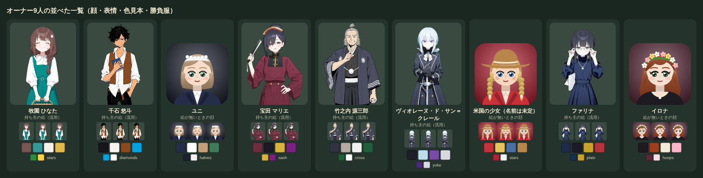

# オーナー9人のキャラクターデザイン（見た目の設計書）

持ち主の言葉「キャラデザは任せます　trpgゲームで作ったノウハウが使えるはずです」（2026-10-20）を受けて作った。オーナー8人と、GF を開いている一族の人（イロナ）の見た目を1人ずつ決め、9人を並べて、シルエットと色がかぶらないことを確かめた。

- 決めたのは**見た目だけ**。名前・年・人柄・台詞・ミッションは `data/owners.js`・`data/gfhost.js` と、持ち主が外で作り直す文が正。年はいまのデータに合わせた。
- **9人とも新しく描く**（持ち主の決定 2026-10-20「TRPGの画像使いまわしじゃなくて新規で生成してほしい」）。いま6人（ひなた・千石・マリエ・竹之内・ヴィオレーヌ・ファリナ）は trpg-game の絵を流用しているが、見た目の設計はその絵の色と形を下敷きにして、このゲームの人として決め直した（元のゲームの持ち物は外した）。新しい絵が来るまでは今の絵のまま出る。
- 絵の生成は、持ち主のパソコンにいる trpg-game のセッションが trpg-game の道具で行う（このリポジトリのクラウドのセッションからは生成しない）。頼む行と依頼文は下の「絵を頼む文」。
- `data/owners.js`・`data/gfhost.js` の `look`（絵を描く手がかり）と `face`（絵が無いときの SVG の顔の色）を、この設計書に合わせて直した。台詞は直していない。

（左から 牧園 ひなた・千石 悠斗・ユニ・宝田 マリエ・竹之内 源三郎・ヴィオレーヌ・米国の少女・ファリナ・イロナ。上が今の顔（6人は流用中の絵、3人は SVG の顔。どれも新しい絵に替わる）、下の小さい3つが表情（ほほえみ・喜び・残念）、その下が色見本4色と勝負服の色・柄。）

## 決めてほしいこと（番号で答えられる形。推しは ◎）

1. **米国の少女の名前**：① ◎ルーシー・ホイットフィールド（呼び名ルーシー）② メイジー・カーター ③ アニー・ブルックス。
2. **米国の少女の勝負服**：① ◎赤と白の縦縞・青い帽子（柄 `stripes`。9人で柄が一つもかぶらなくなる）② 今のまま（赤に白の星。ひなたと柄が同じ星になる）。今の台詞（G2 の場面）が「赤に白の星」なので、①なら台詞を書き直すときに一緒に直す。
3. **ユニの髪と目**：◎ミルクティー色のボブ・緑の目（ほかの8人とかぶらない色）。別のセッションのメイドの絵は待たずに、この見た目で新しく描く。
4. **年の食い違い**：データは 千石 26歳・マリエ 38歳、持ち主のメモは 30歳・33歳。◎メモの年に寄せる。頼む行はこの推しで書いた（千石は 28〜30歳に見える・マリエは 35歳）。
5. **ヴィオレーヌの剣**：「決闘」と言う人だが、◎剣は持たせない（両手を前でそろえて立つ）。持たせるなら、頼む行の tags に `holding a sheathed rapier upright` を足す。

## trpg-game から使ったやり方

trpg-game の `docs/art/README.md`・`portraits.json`・`moods.json`・`style.json` と、知恵袋の skill `image-gen`・`characters` から、このゲームに要る所だけ取った。

- **見た目は固定のタグで書く**：髪の色（2語）・長さ・髪型、目の色と形、肌、眉、印（眼鏡・そばかす・傷）、服の色と形、いつも身につける物、年と体格を `identity` に書き、ポーズと持ち物は `tags`、表情は `face` に分ける（trpg-game V10）。絵師の名に髪の色を引っ張られないよう、髪の色・髪型・目の色は必ず書く（A9・IMG-06）。
- **主要な人を似せない**：髪の色・髪型・目の色・印を人ごとにずらし、二人ずつ並べて確かめる。同じ性別で髪の色と長さがそろった「髪の双子」を作らない（A7・CHR-05）。下の「かぶりの点検」。
- **表情は使うものだけ、その人らしい幅で**：このゲームの表情は4つ（ふだん・ほほえみ・喜び・残念）。trpg-game の差分の名前と `tools/pack_owners.cjs` の対応は下の表。威厳のある人・謎めいた人は崩した顔（大口・涙・汗）を作らない（IMG-32・40）。基本が笑顔の人は、喜びを基本と違う笑い方にする（IMG-47）。
- **表情の差分は基本の絵からの img2img**：見た目とポーズのタグは一字一句同じにし、表情のタグだけ差し替える（IMG-03・49）。
- **大きさと置き方**：512×640（縦長・胸から上・顔が上から1/3）、webp・1枚 80KB 以下。白い無地の背景で作り、trpg-game の抜き方（A20）で透過にする。
- **設定は全部プロンプトに**：年齢・服・持ち物を入れないと若く素朴に描かれがち（IMG-07）。作品名・作家名は特徴のタグに書かない（IMG-28）。露出を抑えるタグと solo は trpg-game の設定にそのまま入っている（IMG-10）。
- **子どもは子どもらしく**：米国の少女は trpg-game の子ども（ルイ）と同じく `child`・年齢・小さな体で書き、性的な語は入れない。trpg-game の設定のネガティブ（nsfw・露出・体の線の語）がそのまま効く。

### 表情の対応（このゲーム ← trpg-game の差分）

| このゲーム | 使う差分（上から順に、あるもの） | 頼むときの差分の名前 |
|---|---|---|
| ふだん（base） | 基本の絵 | `face` |
| ほほえみ（smile） | `_faint_smile` → `_joy` | `faint_smile` か `joy` |
| 喜び（joy） | `_fun` → `_sparkle` → `_joy` | `fun` |
| 残念（sad） | `_sorrow` → `_troubled` → `_panic` | `sorrow` |

## 並べた一覧

| 人 | 年（見た目） | 背丈・雰囲気 | 髪 | 目 | 服の主の色 | 目印 | 勝負服 |
|---|---|---|---|---|---|---|---|
| 牧園 ひなた | 26 | 中くらい・やわらかい | くすんだ栗色・長い・一本の三つ編みを肩から前へ | はしばみ色・笑うと閉じる | 青緑の前掛け＋白い襟 | 麦の穂の髪飾り・かご | 緑に黄色の星 |
| 千石 悠斗 | 28〜30（男。推し） | 中背・やせ型・日焼け | 黒・短い・はね毛 | 琥珀色・鋭い | 白いシャツ＋茶色のベスト | ポケットに片手・スマートフォン | 水色に白のダイヤ |
| ユニ | 21 | 小柄寄り・きちんと | ミルクティー色・あごまでの内巻きのボブ | 緑・丸い | 濃い紺のメイド服＋白いエプロン | 白いフリルの頭飾り・紺の手帳 | 紺と白の半分ずつ |
| 宝田 マリエ | 35前後（推し） | 背が高い・華やか | 黒・結い上げ | 紫・切れ長 | えんじの高い襟のドレス | 羽根の帽子・扇子・金の耳飾り・赤い口紅 | 金に紫のたすき |
| 竹之内 源三郎 | 68（男） | 背が高い・やせ型 | 灰色・後ろで小さな髷・無精ひげ | 糸目 | 墨色に近い紺の着物＋白い紋の羽織 | 扇子・懐中時計 | 深い緑に白の十字 |
| ヴィオレーヌ | 22 | 背が高い・細身・まっすぐ立つ | 淡い水色・肩まで・低い一つ結び | 紫・鋭い・長いまつげ | 黒い長い外套（体に沿う形・白い縁） | 家紋の銀のブローチ・黒い手袋 | 紫に銀の肩 |
| 米国の少女 | 12 | 9人でいちばん小さい・元気 | はちみつ色の金髪・二本のおさげ | 青・丸い | さくらんぼ色のベスト＋デニム | 大きすぎるつば広の帽子・そばかす | （推し）赤と白の縦縞・青い帽子 |
| ファリナ | 28 | 中くらい・細身 | 青みの黒・長い・低い一つ結び・ぱっつんの前髪 | 灰色・細い | 紺の高い襟のドレス | 銀縁の眼鏡・銀の鎖・赤い表紙の帳面 | 紺に金（無地） |
| イロナ | 二十代半ばに見える | 中背・静か | 赤みの強い栗色・腰までの長い波 | 深い緑・やわらかい | 黒いフード付きの旅の外套＋生成りのブラウス | 白・桃・黄の花の花輪・黒い猫 | 濃い葡萄色に薄桃の輪 |

### かぶりの点検

- **髪の色**：黒が3人（千石・マリエ・ファリナ）。千石は男で短いはね毛、マリエは結い上げに羽根の帽子、ファリナは長い一つ結びに眼鏡で、形と印が別。茶の系統は3人（ひなた＝くすんだ栗色・ユニ＝ミルクティー色・イロナ＝赤みの強い栗色）で、明るさと赤みを離した。
- **髪の双子になりかけた組**：ひなたとイロナ（同じ女・栗色・長い）。イロナの髪を赤く濃くし、三つ編み↔下ろした波、青緑の前掛け↔黒い外套、はしばみ色↔深い緑、かご↔花輪で分けた。ヴィオレーヌとファリナ（どちらも低い一つ結び）は、淡い水色↔青みの黒、眼鏡の有無で分かれる。
- **服の主の色**：紺が3人（ユニ・竹之内・ファリナ）。白いエプロンと頭飾り／男の着物の V の襟と白い紋／眼鏡と高い襟、で分かれる。黒が2人（ヴィオレーヌ・イロナ）。ヴィオレーヌは体に沿う外套に白い縁と淡い髪、イロナは肩から広がるフードの外套に赤い髪と花輪で、シルエットが別（細い柱と、裾の広い三角）。
- **シルエット**：頭の形が9人とも違う（三つ編み・はね毛・頭飾り・羽根の帽子・髷・低い一つ結び・つば広の帽子・眼鏡とぱっつん・花輪）。
- **年と体格**：12・21・22・26・28・28〜30・35・68・年の分からない人。背丈は小さい（米国の少女）から高い（マリエ・竹之内・ヴィオレーヌ）まで散らした。お姉さん系が多いので、少女・メイド・老人・若い男を混ぜてある。
- **勝負服**：柄は9人で、米国の少女を縦縞にすれば全部ちがう（星・ダイヤ・半分ずつ・たすき・十字・肩・縦縞・無地・輪）。色が近いのはひなた（明るい緑に黄）と竹之内（深い緑に白）だけで、柄と差し色で分かれる。

## 1人ずつの設計書

色見本は「服の主の色・髪・差し色・もう一つ」の4色。SVG の顔（絵が無いとき）もこの色で描く。

### 1. 牧園 ひなた（地方・ダート）— 新しく描く（`hs_hinata`）

- 髪：くすんだ栗色の長い髪を、一本の三つ編みにして右の肩から前へ。やわらかい前髪。
- 目：はしばみ色のやさしい目。ふだんは笑って目を閉じている。
- 顔立ち：二十代半ば。丸みのある頬、頬に小さな土の汚れ（牧場の仕事帰り）。
- 体格：中くらいの背・細身。前掛けにかごを両手で持つ、働き者の立ち方。
- 服：白い襟のブラウスに青緑の前掛けのワンピース。競馬場では上に何も足さず、仕事着のまま来る（長靴は胸から上の絵には入らない）。
- 小物：麦の穂の髪飾り・差し入れの入ったかご。
- 色見本：`#339996` 青緑・`#7a5650` くすんだ栗色・`#f4f1e8` 白・`#e2b84a` 麦の黄。
- 勝負服：緑に黄色の星（子どものころに描いた絵がもと。牧場の看板と同じ色）。
- 表情：ふだん＝目を閉じたやさしい笑顔／ほほえみ＝口を開けて笑う／喜び＝目を閉じて大笑い／残念＝涙ぐむ。
- 立ち姿の一言：かごを抱えて、だれにでも先に「食べた？」と聞く人。

### 2. 千石 悠斗（短距離）— 新しく描く（`hs_sengoku`）

- 髪：黒の短い髪、あちこちはねる。前髪は横へ流す。
- 目：鋭い琥珀色の目。細い眉。
- 顔立ち：二十代後半の若い男。細い顔・とがったあご・日焼けした肌。
- 体格：中背・やせ型。片手をポケットに入れて、少し斜めに立つ。
- 服：白いシャツの袖をまくり、えりを開ける。茶色のベスト。ネクタイは締めない（会社の社長だが、競馬場では身軽）。
- 小物：スマートフォン・スマートウォッチ・金のストップウォッチ（鎖でベストに留める）。
- 色見本：`#f4f4f0` 白・`#16161c` 黒・`#8a4a1e` 茶・`#00a3e0` 水色（勝負服とスマートフォンの縁）。
- 勝負服：水色に白のダイヤ（デザイナーの三十案から選んだ）。
- 表情：ふだん＝口の端で笑う／ほほえみ＝口を閉じて満足げ／喜び＝歯を見せてにやっと笑う／残念＝目を伏せて口を曲げる。
- 立ち姿の一言：スマートフォンから目を上げずに、結論だけ言う。

### 3. ユニ（クラシック・ナビゲーター）— 新しく描く（`hs_yuni`）

- 髪：ミルクティー色のあごまでのボブ、毛先を内に巻く。まっすぐな前髪。白いフリルの頭飾り。
- 目：緑の丸い目。
- 顔立ち：二十歳を少し過ぎたくらい。ととのった、まじめな顔。
- 体格：小柄寄り。背すじを伸ばし、手帳を胸に抱える。
- 服：濃い紺のメイドのワンピース（丈はひざ下・長袖）・白いエプロン・白い襟。
- 小物：予定を書いた紺の手帳とペン。
- 色見本：`#252d48` 濃い紺・`#ffffff` 白・`#c4a07a` ミルクティー色・`#3f7a5a` 緑。
- 勝負服：紺と白の半分ずつ（メイド服の紺とエプロンの白）。
- 表情：ふだん＝にこやかに手帳を抱える／ほほえみ＝ほほえむ／喜び＝目を輝かせる／残念＝手帳で口元を隠してしょんぼり。
- 立ち姿の一言：ご主人様の一週間を、手帳一冊で先回りしている人。

### 4. 宝田 マリエ（牝馬）— 新しく描く（`hs_marie`）

- 髪：黒髪をきっちり結い上げる。小さな羽根の帽子を斜めにのせる。
- 目：紫の切れ長の目、自信のある目つき。赤い口紅。
- 顔立ち：三十代。はっきりした顔立ち。
- 体格：背が高い。片手を腰に当て、扇子を持つ。
- 服：えんじの高い襟のドレス、金のボタン。銀座の店の主人らしく、競馬場でも装う。
- 小物：扇子・金の耳飾り・紫の宝石のブローチ。
- 色見本：`#6c2e3e` えんじ・`#1a1a24` 黒・`#d9b23a` 金・`#7a2182` 紫。
- 勝負服：金に紫のたすき（お店の包装紙と同じ色）。
- 表情：ふだん＝自信のある笑み／ほほえみ＝ほほえむ／喜び＝扇子で口元を隠して笑う／残念＝目を伏せる。
- 立ち姿の一言：扇子を一振りして、お嬢さんたちを送り出す人。
- 今の流用の絵には表情の差分が無く、4つとも同じ絵が出ている。新しい絵では4つ作る。

### 5. 竹之内 源三郎（長距離）— 新しく描く（`hs_genzaburo`。男の型は老人 `elder`）

- 髪：灰色の髪を後ろで小さな髷に結う。無精ひげ。
- 目：糸のように細い目。ほとんど開けない（開けるのは本気のときだけ）。
- 顔立ち：六十代の後半。ほうれい線としわ。穏やかだが、腹の内を見せない顔。
- 体格：背が高い・やせ型。片手を胸の前に上げて話す。
- 服：墨色に近い紺の着物に、白い紋の羽織。五十年、この格好で競馬場へ来る。
- 小物：閉じた扇子・古い懐中時計（胸元に鎖）。
- 色見本：`#2e3242` 墨紺・`#b4aca4` 灰色の髪・`#f0f0f0` 紋の白・`#1f5f3a` 深い緑（勝負服）。
- 勝負服：深い緑に白の十字（亡くなった家内が選んだ色）。
- 表情：ふだん＝目を閉じて穏やかにほほえむ／ほほえみ＝口を閉じてかすかに笑う／喜び＝目を閉じて声を上げて笑う／残念＝目を閉じて黙る。大口・涙は作らない。
- 立ち姿の一言：笑ったまま、こちらの腕をはかっている人。

### 6. ヴィオレーヌ・ド・サン＝クレール（欧州）— 新しく描く（`hs_violaine`）

- 髪：淡い水色の髪、肩までの長さを低い一つ結びに。
- 目：紫の鋭い目、長いまつげ。
- 顔立ち：二十代の前半。白い肌、硬いまじめな顔。
- 体格：背が高い・細身。まっすぐ立ち、礼をするように手を体の前でそろえる。
- 服：黒い長い外套（体に沿う形・高い襟・白い縁）・白いリボンタイ。
- 小物：家紋の銀のブローチ・黒い手袋。剣は持たない（決めてほしいこと5）。
- 色見本：`#1e1e2a` 黒・`#bcdcee` 淡い水色・`#7a4aa8` 紫・`#d8d8e0` 銀。
- 勝負服：紫に銀の肩（サン＝クレールの色）。
- 表情：ふだん＝まじめで硬い顔／ほほえみ＝ほっとした小さな笑み／喜び＝やわらかくほほえむ／残念＝唇をかんでうつむく。
- 立ち姿の一言：決闘の前のように、まっすぐこちらを見る人。

### 7. 米国の少女（米国。仮の名はルーシー・ホイットフィールド）— 新しく描く（`hs_lucy`）

- 名前：未定（決めてほしいこと1）。ケンタッキーの古い牧場の、祖父の跡を継ぐ孫娘。データはまだ前の人（ダコタ・ベル）のままで、`look` と `face` だけ先にこの設計に合わせた。
- 髪：はちみつ色の金髪を、耳の下で二本のおさげ（三つ編み）に。短い前髪。
- 目：青い丸い目。鼻のまわりのそばかす。
- 顔立ち：12歳くらい。丸い顔、子どもの体つき。9人でいちばん小さい。
- 体格：小さい。帽子が大きすぎて、つばを片手で持ち上げている。
- 服：生成りのシャツにさくらんぼ色のキルトのベスト、デニムのスカート、茶色の短いブーツ。子どもの普段着で、肌は出さない。
- 小物：祖父のおさがりのあめ色のつば広の帽子（大きすぎる）・蹄鉄の形のバッジ。
- 色見本：`#c8303a` さくらんぼ色・`#e8c35a` はちみつ色・`#4a6fa5` デニム・`#b8864a` あめ色。
- 勝負服：（推し）赤と白の縦縞・青い帽子。祖父の牧場の柵の色と、ベストの赤から（決めてほしいこと2）。
- 表情：ふだん＝口を閉じて、にっと得意げに笑う／ほほえみ＝帽子のつばを上げてほほえむ／喜び＝歯を見せて大きく笑う／残念＝口をとがらせる（すぐ立ち直る顔）。
- 立ち姿の一言：大人の馬主たちの間を、帽子を押さえて走り抜けていく子。

### 8. ファリナ（豪州）— 新しく描く（`hs_farina`）

- 髪：青みのある黒の長い髪を低く束ねる。まっすぐな前髪。
- 目：灰色の細い目、銀縁の眼鏡。
- 顔立ち：二十代の後半。表情の少ない、冷たく見える顔。
- 体格：中くらいの背・細身。両手で眼鏡を直す。
- 服：紺の高い襟のドレス。
- 小物：銀の鎖の首飾り・赤い表紙の帳面。
- 色見本：`#1f2a4a` 紺・`#1c1a26` 青みの黒・`#c9a227` 金・`#b8323c` 帳面の赤。
- 勝負服：紺に金（無地）。
- 表情：ふだん＝眼鏡を直す無表情／ほほえみ＝ほんの少し笑う／喜び＝目を閉じてほほえむ／残念＝慌てて汗をかく。
- 立ち姿の一言：数字が「無理」と言うほど、眼鏡の奥が光る人。

### 9. イロナ（GF を開いている一族の人）— 新しく描く（`hs_ilona`）

キンチェムを思わせる人物（本人や化身とは書かない）。花輪・赤みの栗色の髪（栗毛の色）・黒い旅の外套・黒い猫・ハンガリーの刺しゅうで「もしかして」と思わせる。

- 髪：赤みの強い栗色の長い髪を、ゆるく波打たせて腰まで下ろす。頭に白・桃・黄の花の花輪。
- 目：深い緑のやわらかい目、長いまつげ。
- 顔立ち：二十代の半ばに見える。年の分からない、静かな顔。
- 体格：中背。黒い猫を両腕に抱いて立つ（全身の絵なら猫は足もと）。
- 服：黒いフード付きの旅の外套（前を開けて肩から広がる）・生成りの立ち襟のブラウス（襟に赤と緑の小さな刺しゅう）。
- 小物：花輪・首に細い金の鎖・黒い猫・古い招待状。
- 色見本：`#1e1a22` 黒・`#9c3f1a` 赤みの栗色・`#f3ead8` 生成り・`#ffb3c8` 花の桃（ほかに花の白 `#ffffff`・黄 `#ffe07a`）。
- 勝負服：濃い葡萄色に薄桃の輪（データのまま）。
- 表情：ふだん＝静かにほほえむ／ほほえみ＝目を細める／喜び＝花輪を差し出して笑う（大口にしない）／残念＝目を伏せる（それでもほほえんでいる）。泣き・慌ては作らない。
- 立ち姿の一言：汽車で少し遅れて着き、黙って花輪を編んでいる人。

## 絵を頼む文

持ち主の決定（2026-10-20）「オーナー9人のデザイン　TRPGの画像使いまわしじゃなくて新規で生成してほしい　生成の仕方はTRPGセッションがしってる」「表情差分も作り方知ってるはず」。9人とも、この設計書の見た目で新しく描く。生成は持ち主のパソコンにいる trpg-game のセッションが、trpg-game の道具（Stable Diffusion WebUI と `tools/gen_portraits.mjs`）と絵柄（`docs/art/style.json`。男は `style_male.json` の型）で行う。9人を同じ絵柄・同じ設定で描くので、画風がそろう。

- 頼む行：[`docs/art/owner_portraits.json`](art/owner_portraits.json)（9人。trpg-game の `docs/art/portraits.json` の `portraits` にそのまま足せる形。id は `hs_hinata`・`hs_sengoku`・`hs_yuni`・`hs_marie`・`hs_genzaburo`・`hs_violaine`・`hs_lucy`・`hs_farina`・`hs_ilona`）。
- trpg-game のセッションに貼る依頼文：[`docs/art/OWNER_PORTRAITS_REQUEST.md`](art/OWNER_PORTRAITS_REQUEST.md)。
- 特徴のタグだけを書いた。画風・品質・構図・ネガティブ（露出・複数人）は trpg-game の設定が足す。作品名・作家名は書いていない。
- 表情は、基本の絵（ふだん）と3つの差分（ほほえみ＝`joy` か `faint_smile`・喜び＝`fun`・残念＝`sorrow`）。`tools/pack_owners.cjs` がこの順で拾う。竹之内・ヴィオレーヌ・ファリナ・イロナは崩した顔を作らない（大口・涙・汗なし）。基本が笑顔の人（ひなた・マリエ・ユニ・ルーシー・イロナ）は、喜びを基本と違う笑い方にした。
- 米国の少女の id と名前（`hs_lucy`・ルーシー・ホイットフィールド）は仮。持ち主の返事で名前が変わっても、絵の id はこのままでよい。
- 新しい絵が来るまでは、ゲームは今の流用の絵（ユニ・米国の人・イロナは SVG の顔）のまま。`tools/pack_owners.cjs` は新しい id の絵があればそちらを使う。
