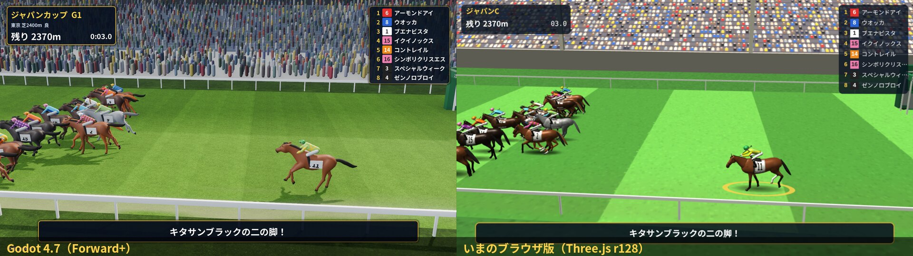
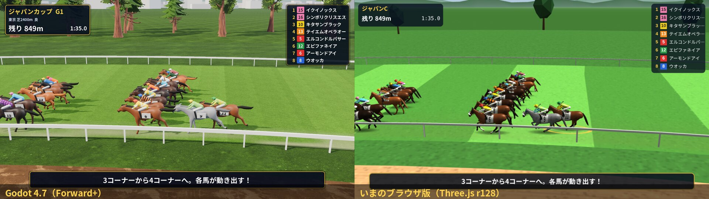
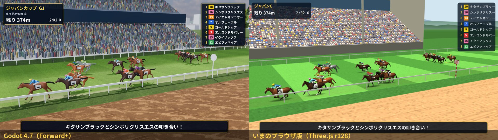
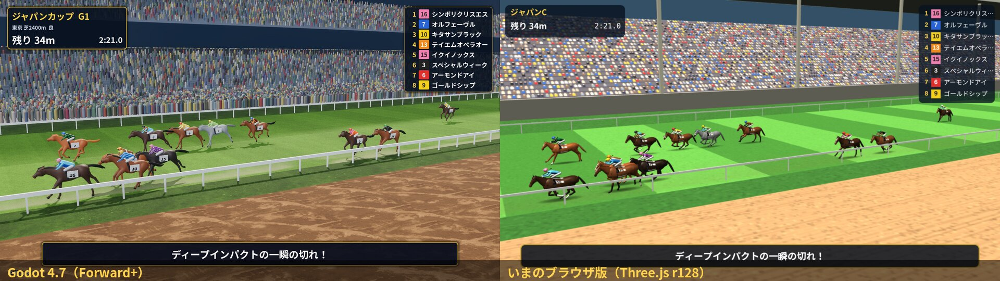
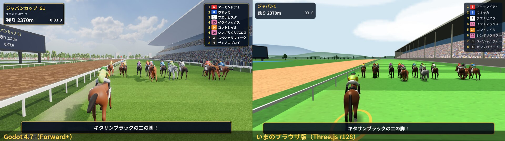
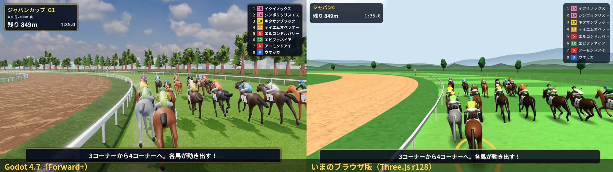
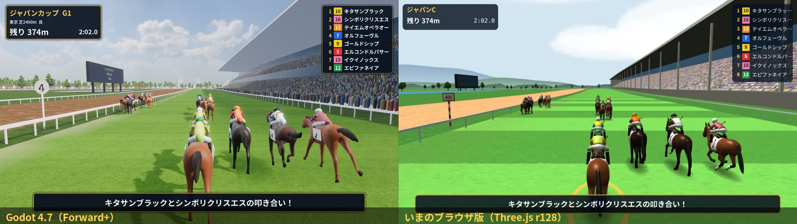
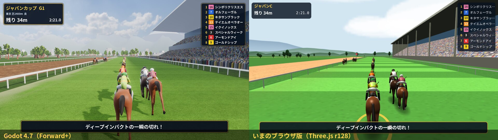

# Godot の試作とブラウザ版の見比べ（2026-10-16）

同じレースの記録（`tools/export_race.js`。ジャパンカップ・東京 芝2400m・史実馬16頭・種 20251130）を、同じ秒・同じカメラの決め方で撮った。
左が Godot 4.7.2（Forward+）、右がいまのブラウザ版（Three.js r128、`js/ui/watch3d.js` の観戦の画面）。
どちらもこの container で撮った（Godot は Xvfb と lavapipe、ブラウザ版は Chromium と SwiftShader）。GPU は使っていない。

自分の馬は 11番ディープインパクト（出遅れた）。勝ったのは 16番シンボリクリスエス。

## 見比べ（中継のカメラ）
| 場面 | 絵 |
|---|---|
| スタート直後（3秒・残り2370m） |  |
| 3コーナー（95秒・残り849m） |  |
| 直線（122秒・残り374m） |  |
| ゴール前（141秒・残り34m） |  |

## 見比べ（騎乗のカメラ）
| 場面 | 絵 |
|---|---|
| スタート直後 |  |
| 3コーナー |  |
| 直線 |  |
| ゴール前 |  |

- 1枚ずつの 1920x1080：`godot/`（Godot）と `web/`（ブラウザ版）。
- 寄りの絵（Godot だけ。自分の馬の内側から）：`godot/1_start_close.jpg`・`godot/3_straight_close.jpg`・`godot/4_goal_close.jpg`。
- 動き（137〜140.6秒の10枚、0.4秒ごと）：`seq/godot_tv_01〜10.jpg`・`seq/web_tv_01〜10.jpg`（騎乗は `*_ride_*`）。GIF は `seq/godot_tv.gif` ほか。

## 見た目の差
- **光と影**：Godot は太陽の影（4段の影の地図）・物の隅の暗がり（SSAO・SSIL）・空の光（HDRI の空から周りの光と映り込み）が一行ずつの設定で入る。ブラウザ版は影が円の印で、光は半球の光と太陽だけ。馬群の立体感の差がいちばん大きい。
- **空と遠く**：Godot は写真の空（Poly Haven の HDRI）と霞（遠いほど空の色に溶ける）。ブラウザ版は色の段の空で、遠くがくっきり切れる。
- **地面**：Godot は芝・ダートに写真の質感と凹凸（法線）を貼り、刈り目の縞を薄く入れた。ブラウザ版は単色の縞で、明るい黄緑が目立つ。
- **スタンドと観客**：Godot は段の形を押し出して、約3万人を MultiMesh で座らせた。ブラウザ版は観客を質感の絵で描いているので、近づくと平らに見える。
- **馬**：差が小さい。Godot は Quaternius の CC0 の馬（骨と襲歩付き。低いポリゴン）を毛色で塗り、法線をならして使った。体つきの写実さは、手作りのブラウザ版の馬と同じくらいか、脚の細さではブラウザ版が上。どちらのエンジンでも「安っぽさ」が残るのは馬の形で、良い馬のモデル（有料か、作ってもらう）が要る。
- **字**：Godot は Noto Sans JP を入れて、画面の大きさに関係なく同じ形で出る。

## Godot に移すとしたら
### 移す量の見積もり
| もの | いまの量 | Godot で | 目安 |
|---|---|---|---|
| データ（`data/*.js`、29ファイル・4.4MB） | JS の表 | node の道具で JSON に書き出して読む（手で移さない） | 子1つ |
| 仕組み（`js/core/*.js`、約3,800行。模擬・世界・騎手・シーズン・年代なし・スペシャルホース・配合など） | JS | GDScript に移す。種つきの乱数（`U.RNG`）を同じ結果になるように移し、同じ種で JS と Godot の結果を突き合わせるテストで確かめる | 子3〜5 |
| 画面（`js/ui/*.js` 約5,700行・`css/style.css` 約600行。管理画面・出走表・成績・殿堂・エディット） | HTML と canvas | Control のノードと Theme で作り直す。いちばん量が多い | 子6〜10 |
| 騎乗の操作（`js/ui/ride.js`） | キーボード・ゲームパッド・タッチ | Godot の入力の割り当て（ゲームパッドは標準で使える） | 子1〜2 |
| レースの画面 | `js/ui/race3d.js` 約1,500行 | この試作が土台（約1,700行）。ゲート前のカメラ・写真判定・ムチの動きを足す | 子2〜3 |
| 音（`js/ui/audio.js`、Web Audio で作る曲と音） | Web Audio | Godot の AudioStreamGenerator で作り直すか、同じ JS で曲を書き出してファイルにする（「音のファイルは使わない」を変えるなら持ち主の判断） | 子1〜2 |
| テスト（`tests/run.js`） | node | `godot --headless -s` で回す GDScript のテストに移す。データの検査は node のまま残せる | 子1〜2 |
| セーブ | localStorage | `user://` の JSON。`World.migrate` はそのまま移す | 仕組みの中 |

合わせて子 15〜25 ほど。並行のレーン（データ・仕組み・画面・レース）に分けられる。仕組みと画面は JS と同時に直せないので、移している間は JS 版に新しい仕組みを足さない決まりが要る。

### できなくなること・変わること
- **ブラウザで遊べなくなる**：GitHub Pages のリンクを開くだけでは遊べない。Godot にも Web への書き出しはあるが、Compatibility（WebGL2）の描き方になり、影・SSAO・SSIL などの質は落ちる。持ち主が手元で確かめるのは、書き出した実行ファイル（Windows）か、Godot のエディタで開く形になる。
- **`file://` で開く・ビルド無し**の決まりは外れる。代わりに「Godot で書き出す」手順が入る。

### Steam への出し方
- Godot の書き出し（Windows・Linux・macOS）で実行ファイルを作り、Steamworks の SteamPipe で上げる。Steam Deck は Linux 版がそのまま動く。
- 実績・クラウドセーブは GodotSteam（MIT の拡張）で使える。
- 書き出しには Godot の書き出し用テンプレート（約1GB）が要る。

### この container で作り続けられるか
- **動く**：Godot 4.7.2 の Linux 版がそのまま動いた。`--headless` で素材の取り込み・GDScript の実行・テストが回る。
- **絵を撮る**：Xvfb と mesa の lavapipe（`apt-get install mesa-vulkan-drivers`）で Forward+ のまま撮れた。1920x1080・影と SSAO 込みで1枚 8〜12秒（CPU で描くので、ゲームの速さの目安にはならない）。撮る道具は `godot/tools/shot_godot.sh`。
- **書き出し**：テンプレートを落とせば `godot --headless --export-release` で Windows・Linux 版を作れる（ネットワークは通る）。Linux 版はここで動かして確かめられる。Windows 版は動かして確かめられない（Wine を入れれば試せる）。
- **測れないこと**：本物の GPU での速さ（60fps が出るか）。持ち主の PC で一度測る必要がある。

## 推しの結論
**移す。ただし段階を踏む。**
- 見た目の差は、ほとんどが光・影・空・質感から来ている。Godot ではこれが設定だけで入り、PC だけで売るなら Web の制約を気にしなくてよい。Three.js でも同じ素材と後処理を足せば近づけるが、r128 は古く、後処理と影を自分で組む量が多い。
- 移す順番：①データを JSON に書き出す道具 → ②模擬と乱数を GDScript に移し、JS と同じ結果になるテスト → ③レースと騎乗の画面（この試作を広げる）→ ④管理画面 → ⑤音。③が終わるまでは JS 版を遊べる版として残す。
- 移さない道もある：Three.js のまま Electron などで包めば Steam に出せる。そのときは同じ CC0 の素材（HDRI の空・質感）と影・後処理を Three.js に足すことになり、量は少ないが上限は Godot より低い。
- 移すかどうかと別に、**馬のモデル**は決める必要がある。CC0 の低ポリの馬では、どちらのエンジンでも写実には届かない（有料の素材か、作ってもらうか。持ち主の判断）。

## 使った素材
`godot/CREDITS.md` に1つずつ書いた。馬と木は Quaternius（CC0）、空と芝・ダート・草地の質感は Poly Haven（CC0）、字は Noto Sans JP（SIL OFL 1.1）。
