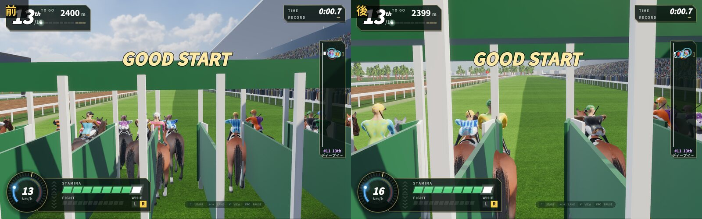
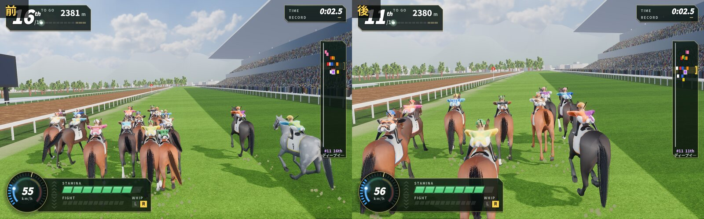
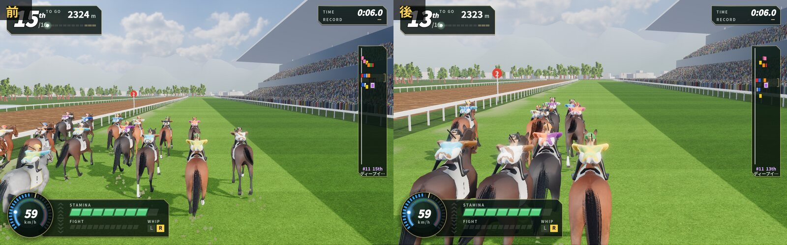
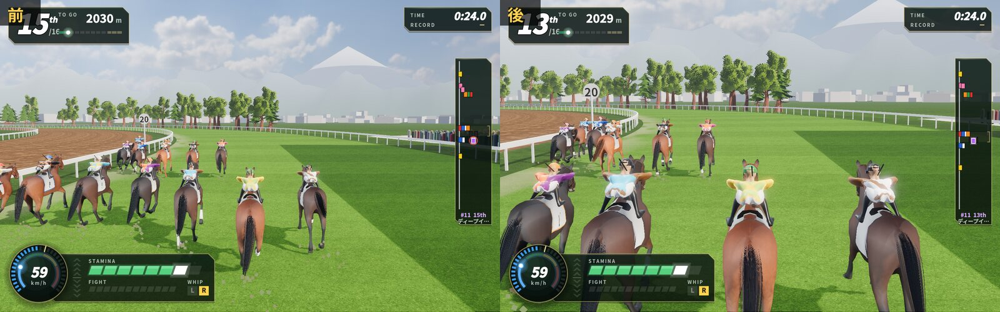
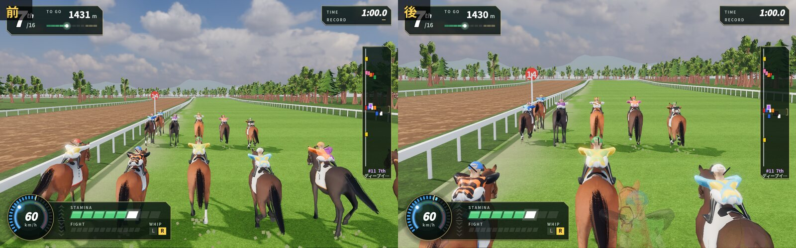
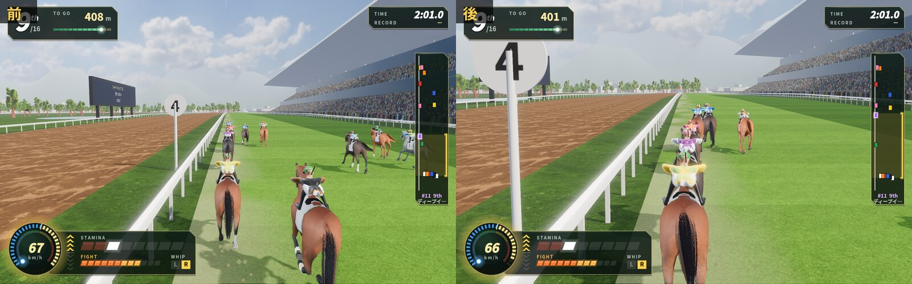
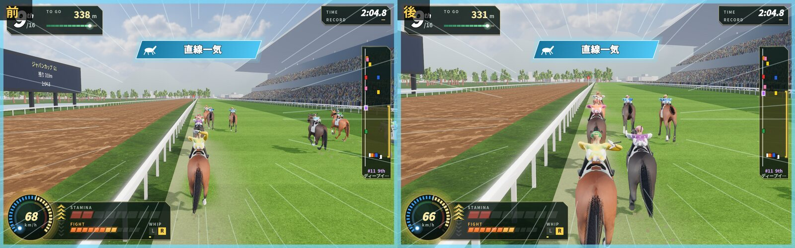

# 騎乗の手ざわりの前と後（2026-10-17）

持ち主の指摘「馬のモーションや操作感これ参考にしてブラッシュアップして」「操作感は生き物に乗ってる手応えがほしい」への対応（`docs/FEEL.md` 2・8、`docs/HORSE3D.md` 9）。参考の動画のコマはリポジトリに入れていない。

撮り方：`sh godot/tools/run_scene.sh res://scenes/race.tscn -- --out=DIR --press=0.02:ride_up --press=117〜127 に 0.45 秒ごと:ride_up --press=124.6:ride_whip_r --shot=秒:jockey:名前`（東京 芝2400m・史実馬16頭・自分は11番。1600×1000）。騎手の形は `res://scenes/horse_lab.tscn -- --cam=jside|jback --push= --hold= --whip=`。

| 場面 | 前と後（左が前） |
|---|---|
| ゲートを出た直後（0.7 秒） |  |
| 出て 2.5 秒（カメラがゲートから寄る途中） |  |
| 出て 6 秒（脚質ごとに前後へ分かれ、縦長になる） |  |
| 1コーナー（24 秒） |  |
| 道中の真後ろ（60 秒） |  |
| 追っているところ（121 秒） |  |
| ムチ（124.8 秒） |  |

- 1枚ずつの後の絵：`after_1600_*.jpg`。
- 騎手：追う1完歩の4コマ（上が前・下が後）`jockey_push_before_after.jpg`、ムチの振り（後の4コマ）`jockey_whip_after.jpg`・前 `jockey_whip_before.jpg`、道中と抑える（後）`jockey_cruise_hold_after.jpg`、真後ろ `jockey_back.jpg`。
