# Godot 版の見た目と操作（gdview・第1段・2026-10-16）

この container で撮った（Godot 4.7.2・Xvfb と mesa の lavapipe＝CPU の Vulkan。GPU は使っていない）。絵は 1600×1000、動画は 960×600（軽い描き方 `--fast`：画面の後処理と影を落とした）。
レースは gdcore の模擬（`HSSim`。JS と同じ結果）をその場で回し、決まった操作（`--press`）で乗った。自分の馬は 11番ディープインパクト。
撮り方は `godot/README.md` の「確かめる・撮る」。

## 絵
| 場面 | 絵 | 見どころ |
|---|---|---|
| 出走表 | 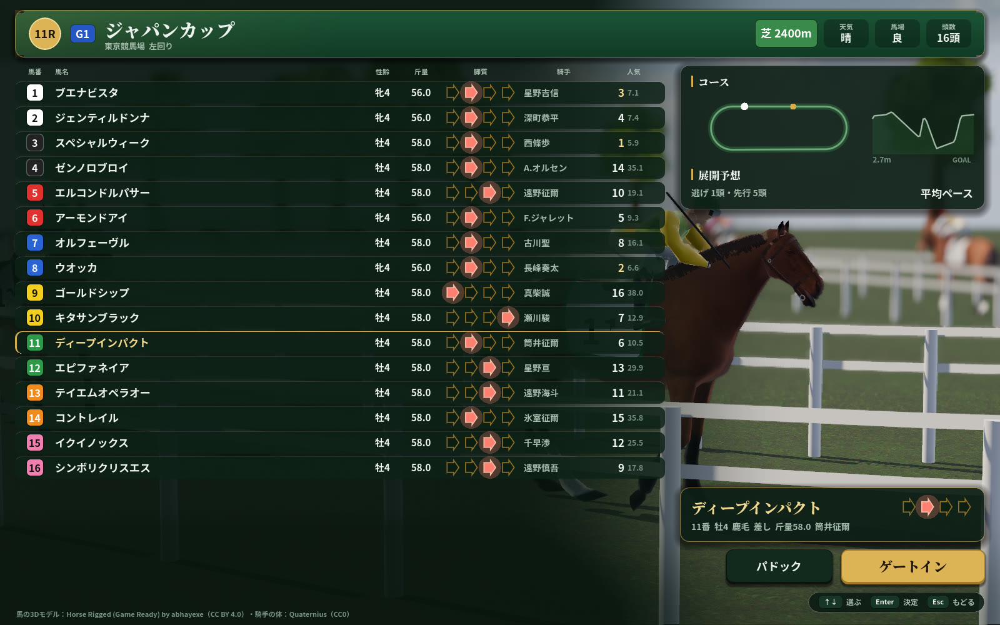 | 16頭（18頭まで）が1画面。1行36px。脚質の矢印（右ほど前）・騎手・人気。右にコース図と高低差・展開予想、選んだ馬の札、パドック／ゲートイン（金）、操作の案内。後ろはパドックを歩く馬 |
| パドック | 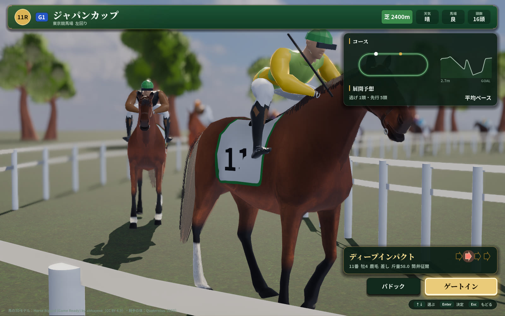 | 選んだ馬のまわりをゆっくり回る（遠くはぼかす）。常歩の4拍子・首のうなずき |
| ゲート | 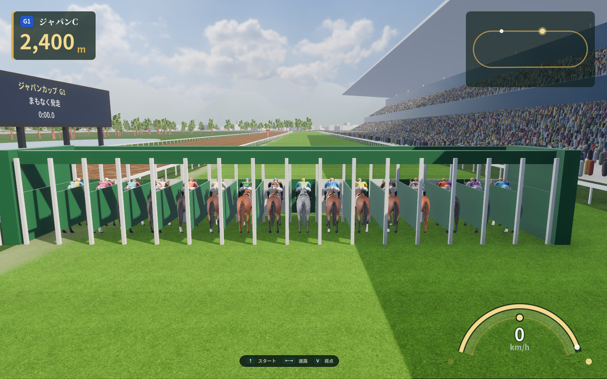 | 発走の前。ゲートの中だけ操作の案内が出る |
| スタート | 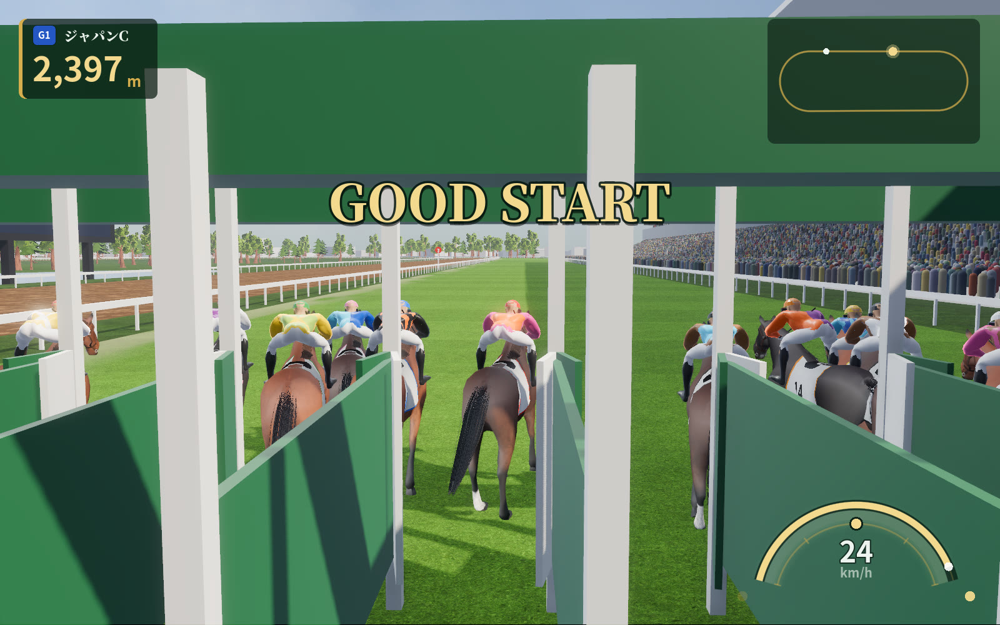 | 開く直前にしごくと GOOD START（短い合図は英語） |
| 騎乗（後ろ） | 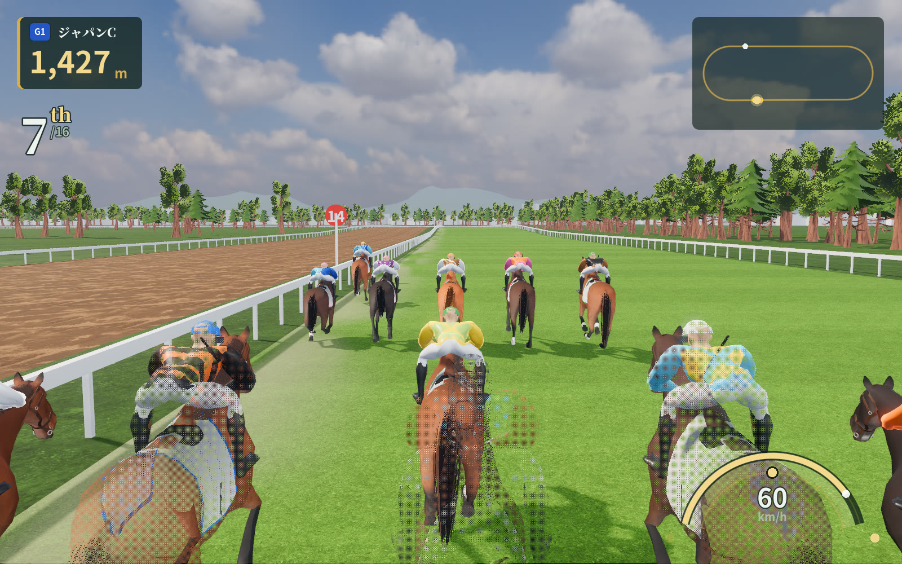 | カメラの前の馬は網目で消す。左上に残りと順位、右上にミニマップ、右下に計器 |
| 騎乗（騎手の目） | 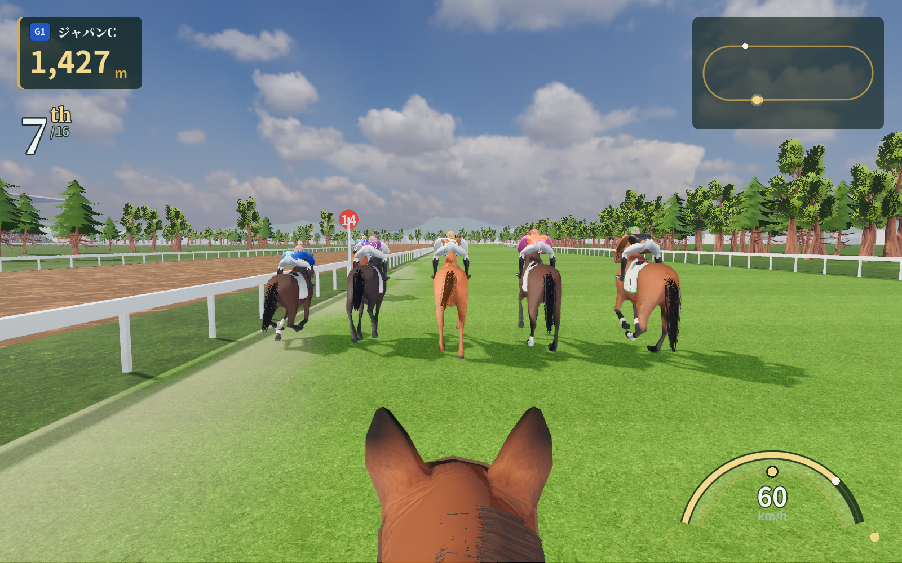 | 馬の耳とたてがみ越しに |
| 中継 | 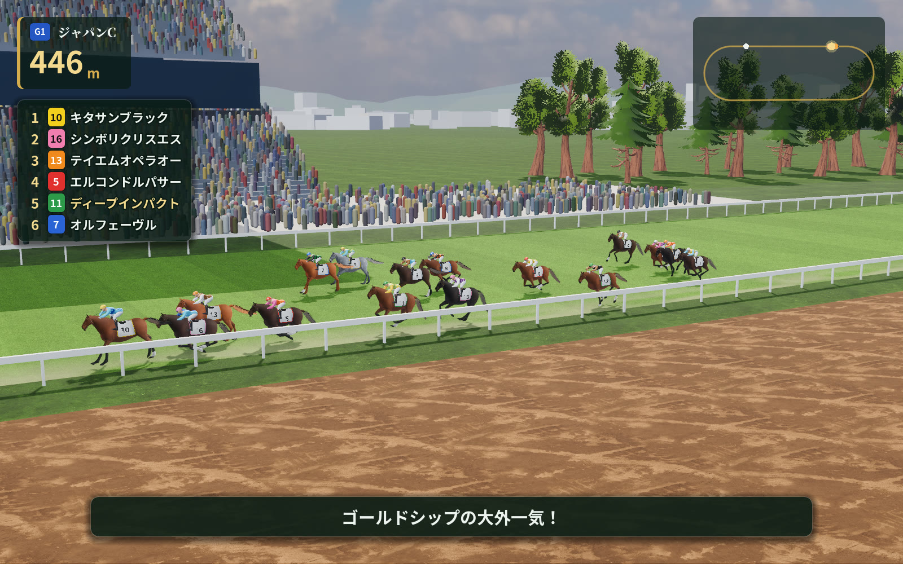 | 先頭集団を横から。上位6頭と実況の字幕（中継のときだけ） |
| 直線 | 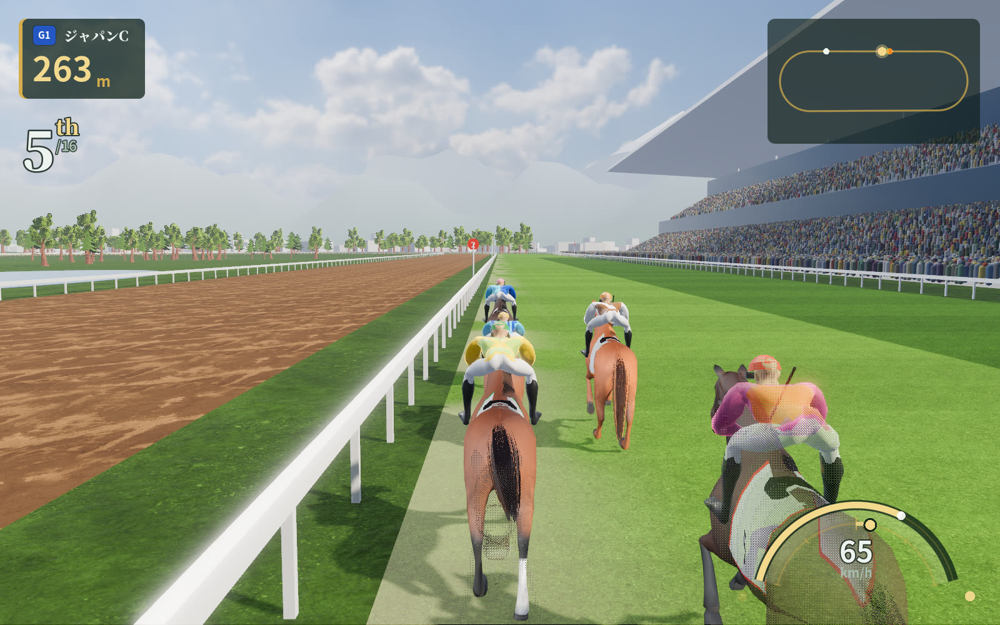 | 追っている（計器の内の弧＝手綱の段が右へ） |
| ゴールのあと | 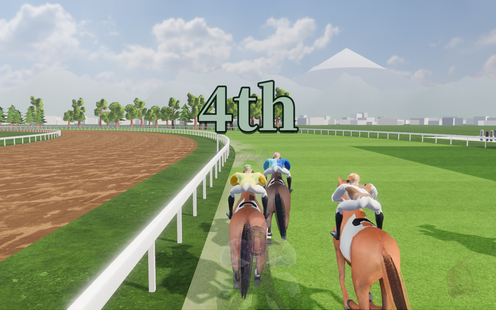 | ゴールしてから3秒流して減速してから、着順を大きく（英語の序数）とタイム |
| 確定 | 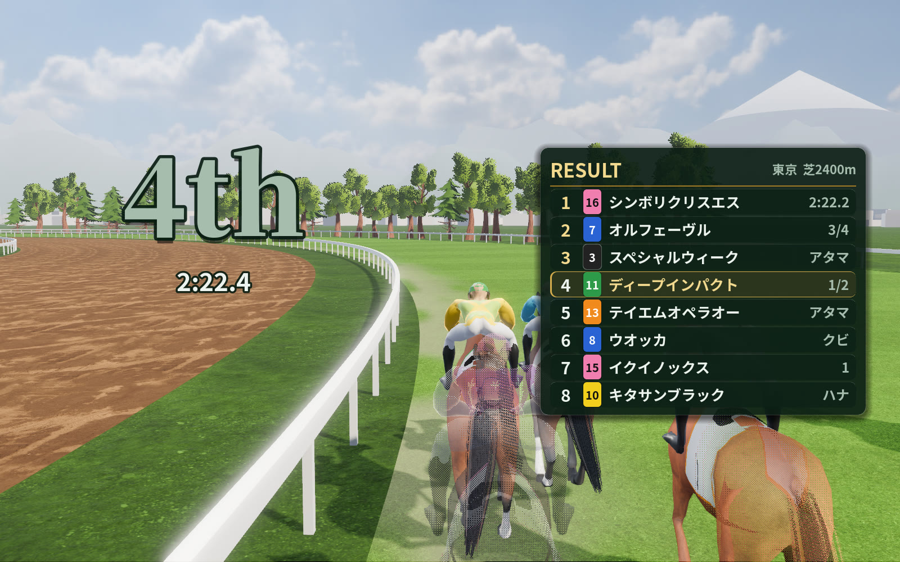 | 確定の表（自分の馬の行は金の縁） |
| 馬と騎手 | 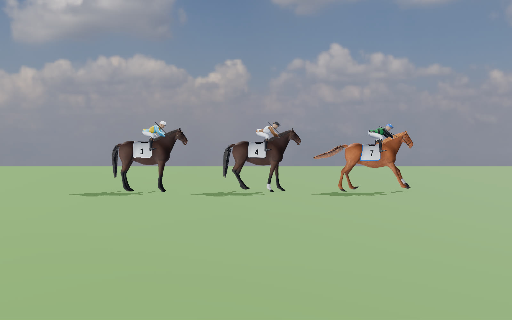 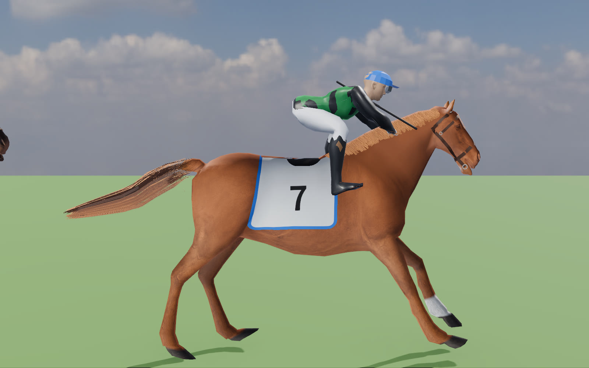 | 立ち姿・常歩・襲歩。鞍の下の布と番号は体の面に沿って骨で動く。騎手は素材の体を IK で鐙と手綱へ |

## 動画（960×600）
| 場面 | 動画 |
|---|---|
| ゲート → GOOD START → 走り出し | [start.mp4](start.mp4) |
| 出走表に入る（帯・行・右の札の入りの動き） | [card.mp4](card.mp4) |
| 十字キー右で外へ出す | [lane.mp4](lane.mp4) |
| 騎手の目で追ってムチ | [jockey.mp4](jockey.mp4) |
| 直線 → ゴール → 流す → 着順 → 確定 | [finish.mp4](finish.mp4) |
| 中継のカメラ | [tv.mp4](tv.mp4) |

## 自分の点（0〜2 点）
### 出走表（docs/UI.md の 6 つの物差し。合格は 12 点のうち 10 点以上で 0 点が無いこと）
| A 状態がひと目で | B 次に押す所 | C 文字が多すぎない | D テーマ・写しでない | E 部品がそろう | F スクロールしない | 計 |
|---|---|---|---|---|---|---|
| 2 | 2 | 2 | 2 | 2 | 2 | **12** |
- A：帯の1行でレース・馬場・頭数、表で全頭、自分の馬は左の金の線。B：主な操作は金の「ゲートイン」1つで、最初のカーソルもそこ（↑で表へ入る）。C：説明の文は無く、選んだ馬の札の1行だけ。D：深緑と金・明朝の題字・後ろにパドック。英語の飾り文字は使っていない（ボタンも日本語）。E：帯・数の札・格の札・枠の札・表の行・ボタンは `godot/ui/theme.gd` の部品。F：18頭で表の下の端は 846px（1000 の中）。
- まだのこと：近走の着順の列（世界の進み＝world.js が Godot に移ってから）。人気は強さの見込みからの仮の値（world.js の setOdds と同じ式。種はレースの名前）。

### 騎乗（受け持ちの物差し）
| ひと目で状態が分かる | 次に押す所が分かる | 文字が多すぎない | 騎乗中に文字で結果を出していない | 揺れがなめらか | 計 |
|---|---|---|---|---|---|
| 2 | 2 | 2 | 2 | 2 | **10** |
- 状態：残りの距離・順位（英語の序数）・速さの数・脚の残り（外の弧）・手綱の段（内の弧の光る印）・ムチの手（左右の点）・馬の気分は弧の地の色（落ち着き＝白金、高ぶり＝赤くゆっくり脈打つ）。文字の状態（溜めている・折り合っている など）は出さない（持ち主の指摘「溜めてるとか折り合ってるとか表示いらない」「折り合いゲージとかダサい」）。
- 次に押す所：ゲートの中だけ操作の案内を出し、走り出すと消える。押すと計器の印がすぐ動き、短く震える。
- 揺れ：ムチでカメラを揺らさない（持ち主の指摘「ムチうつとガクガクゆれる」）。後ろのカメラは馬の胴の上下の 35% だけを遅れてなめらかに追い、騎手の目は頭の上下をばねで吸う。横の馬にぶつかったら（模擬が出したら）、カメラでなく馬が横へよれる。
- ゴール：ゴールしてから 3 秒流してから着順、5 秒で確定の表（持ち主の指摘「ゴールしたら少し走ってから順位表示して」）。
- 十字キー：十字キー・左スティック・矢印キーのどれでも押したコマで進路を出し、押し続けると 0.28 秒ごとに続けて動く（持ち主の指摘「パッドの十字キーで横移動できない」。`godot/tools/check_input.gd` で確かめる）。

## 次に直すこと
- docs/FEEL.md（騎乗の手ざわり）が届いたら合わせる。
- 進路を押したらすぐ動く新しい模擬（JS の S.LANE と c.bumpT）を gdcore が移したら取り込む（見た目の側はもう読める）。
- 蹴り上げの土・芝、騎手の追う動きの強弱、計器のムチの回数。
