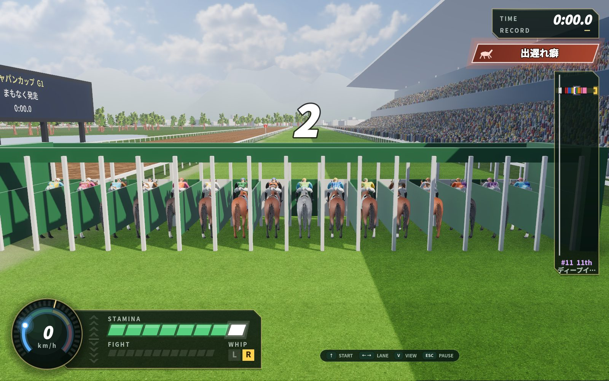
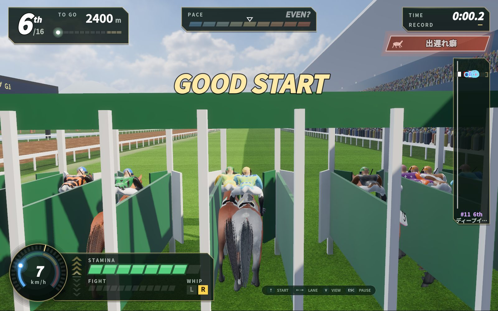
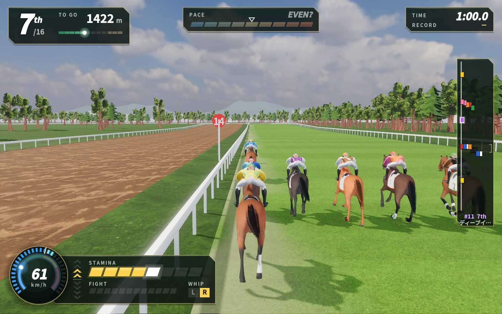
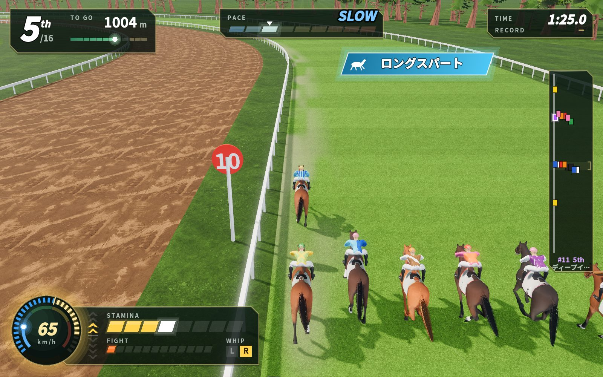
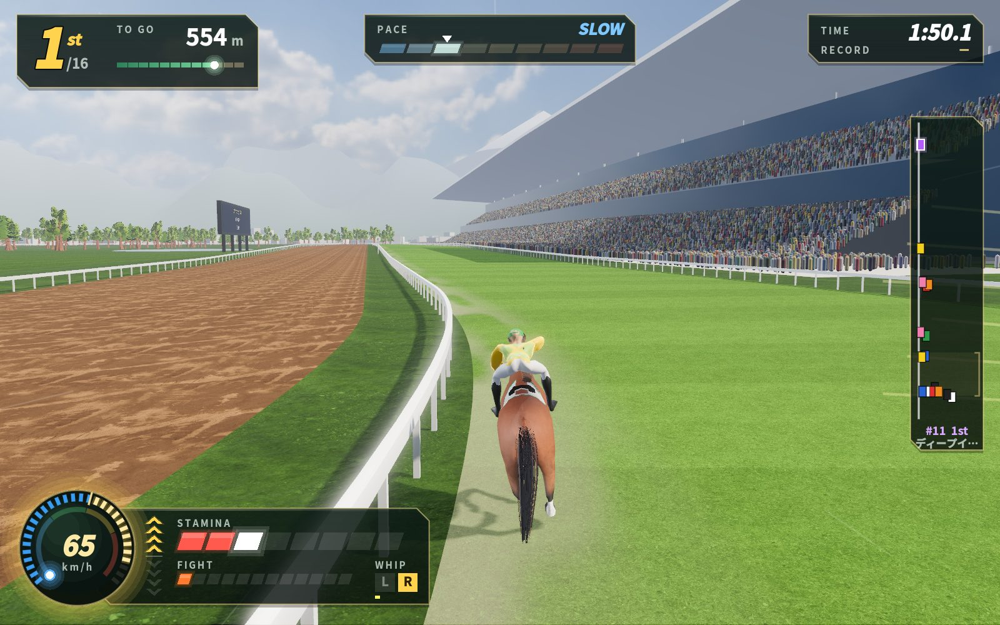
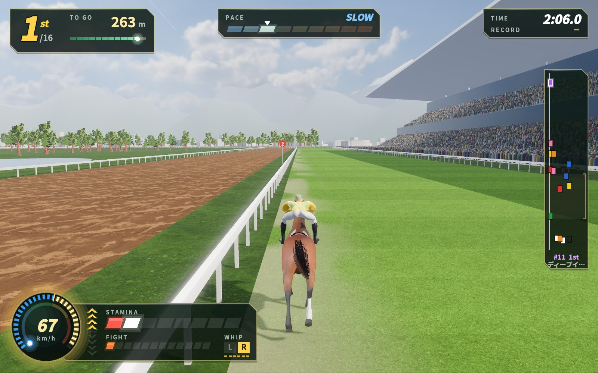
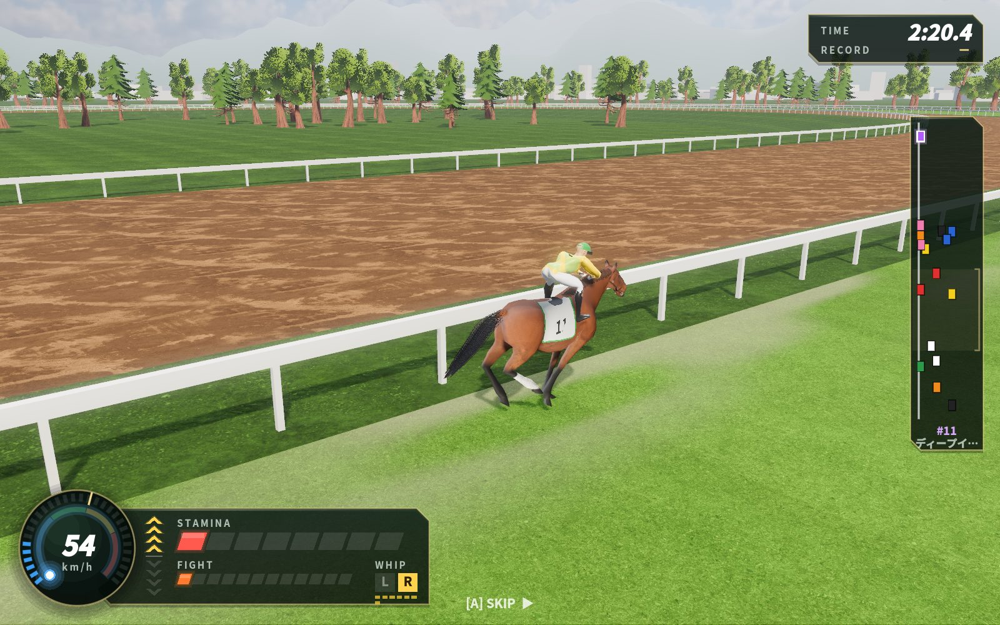
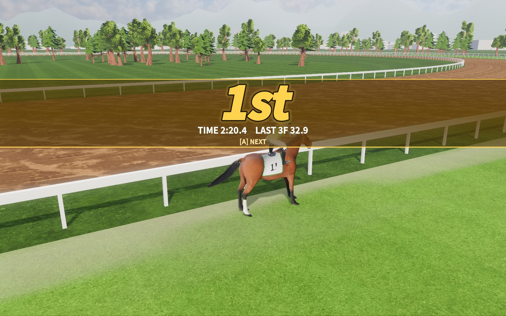
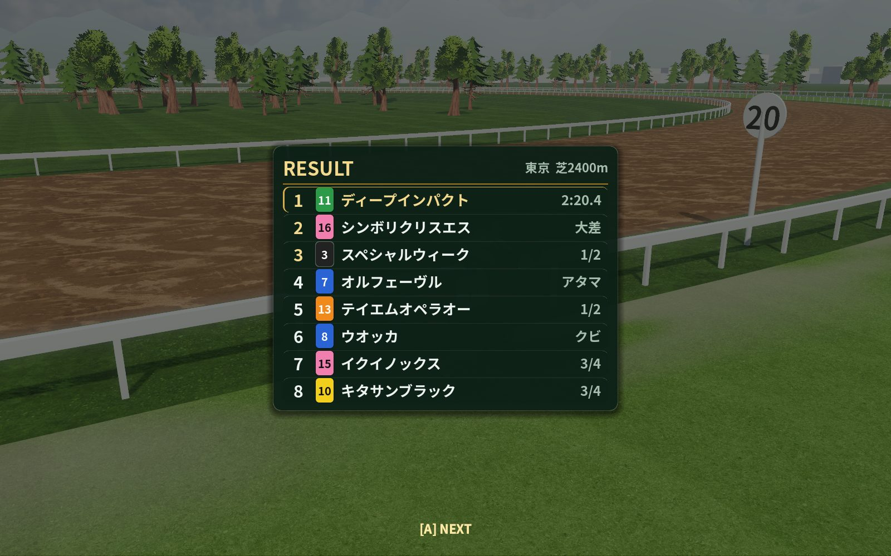
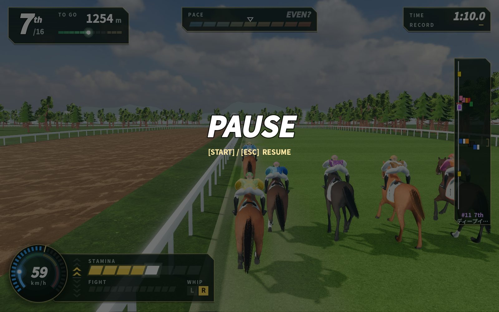

# Godot 版の騎乗を docs/FEEL.md に合わせた（gdview・第2段・2026-10-17）

この container で撮った（Godot 4.7.2・Xvfb と mesa の lavapipe＝CPU の Vulkan）。絵は 1600×1000、動画は 960×600（軽い描き方 `--fast`）。
レースは gdcore の模擬（`HSSim`）をその場で回し、決まった操作（`--press`。スタートは開く 0.1 秒前の先行入力）で乗った。自分の馬は 11番ディープインパクト（1着・2:20.4）。

## 絵
| 場面 | 絵 | 見どころ |
|---|---|---|
| ゲート |  | 3・2・1 が真ん中でふくらむ。操作の案内（英語）は計器の塊の右 |
| スタート |  | 開く 150ms 前の ↑ を覚えて、開いた瞬間に GOOD START（kick の揺れ：縦 5cm・画角 +3°） |
| 道中 |  | 計器は4か所（左上＝順位と TO GO の帯・上＝PACE・右上＝TIME/RECORD・右＝馬群のレーダー）と左下の1つの塊（丸い計器・手綱の段・STAMINA・FIGHT・WHIP）。判定の前のペースは白抜きの印と「EVEN?」 |
| HIGH CAM |  | 上へ 0.42rad・1.7 倍引く。自分の特殊能力の札（ロングスパート）が右上へ退いて残る |
| ムチ |  | 打った側の端に短い光の筋、計器の WHIP に点。画面と計器は揺らさない（カメラだけ横 3cm の kick）。追い出して丸い計器の縁が金に光る |
| 直線 |  | スタミナ残り2つで赤く点滅、レーダーの括弧（得意な位置） |
| 流す |  | ゴール板のあと 2.4 秒は着順を伏せ、馬は映像の側で減速、カメラは斜め横へ回る。下に「[A] SKIP ▶」だけ |
| 着順 |  | 帯が左右から伸び、序数を叩きつけ、TIME と LAST 3F |
| 確定 |  | A で確定の表、もう一度 A で出走表へ |
| 一時停止 |  | Esc・P・Start。ほかの窓へ移ると自動で止まる |

## 動画
- [finish.mp4](finish.mp4)：直線の終わり → ゴール板（白い光・160ms のスロー）→ 流す → 着順（レースの 136〜148 秒・24fps）

## 採点（docs/FEEL.md 6。0〜4 点、合格は 16 点以上でどの軸も 3 点以上）
| 版 | A ひと目で | B 文字で返さない | C 計器 | D 反応 | E 待たせない | 計 |
|---|---|---|---|---|---|---|
| 前（v1） | 2 | 4 | 2 | 3 | 2 | 13 |
| 今（v2） | 3 | 4 | 3 | 4 | 4 | **18** |

- 前（v1）：A 得意な位置が分からず、掛かりは弧の地の色だけ。C 計器が右下とミニマップに分かれ、板の作りがそろっていない。D 揺れは無いが、進路に振動が無い。E ゴールのあと 3 秒＋5 秒の待ちが飛ばせず、一時停止も無い。
- 今（v2）：A 7つとも言えるが、得意な位置の括弧はレーダーの脇で細く、1つ迷う（3）。B 騎乗中の文字は英語の見出しと数・馬名・特殊能力の名前だけ（4）。C 板・升・色は JS 版と同じ作りで、ペースの板も丸い計器と同じ斜めの升にした。光る所はまだ少し多い（スタートの札と特殊能力の札が重なる）（3）。D しごく・引く・進路・ムチ・持ち替え・視点のどれも、押したコマで計器の光と振動（とカメラ）で返る。揺れは減衰する正弦の kick で、上限は横 10cm・縦 5cm・ロール 0.012rad（4）。E ゴールから着順まで 2.4 秒（押せば 0.35 秒で飛ぶ）、着順から先は押すまで待つ、一時停止できる（4）。
- まだ：効果音（しごく・引く・進路・ゴール）は音の係の Godot 版の音が入ってから鳴らす。今は振動で返している。
